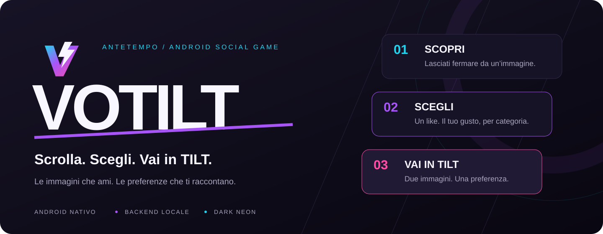
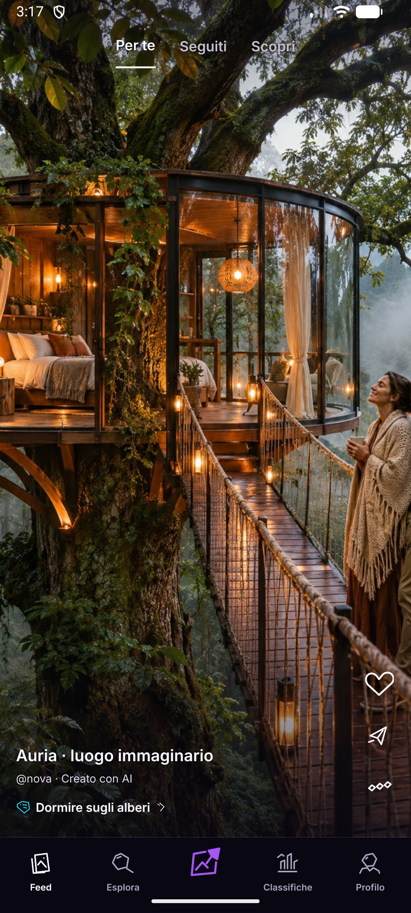
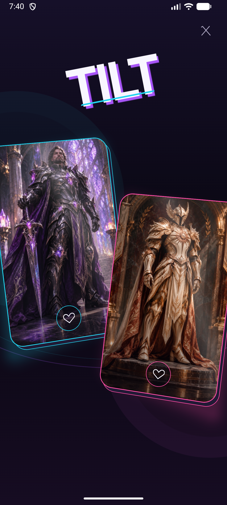
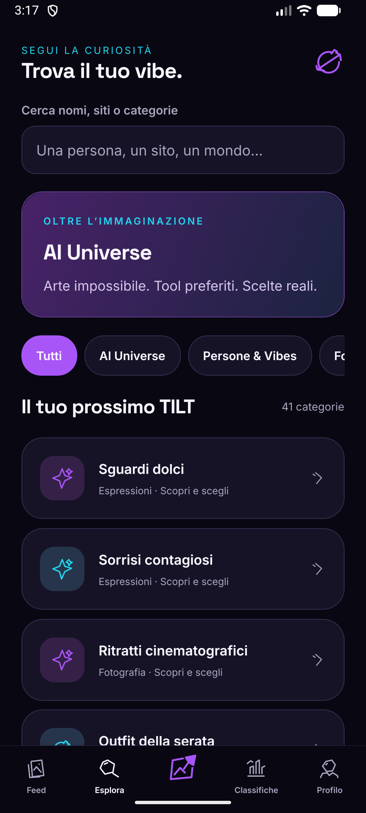
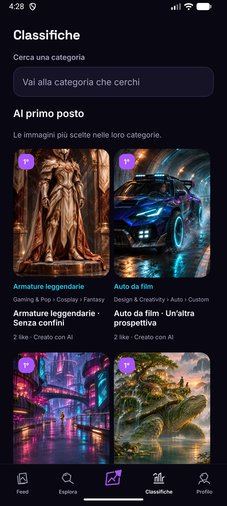
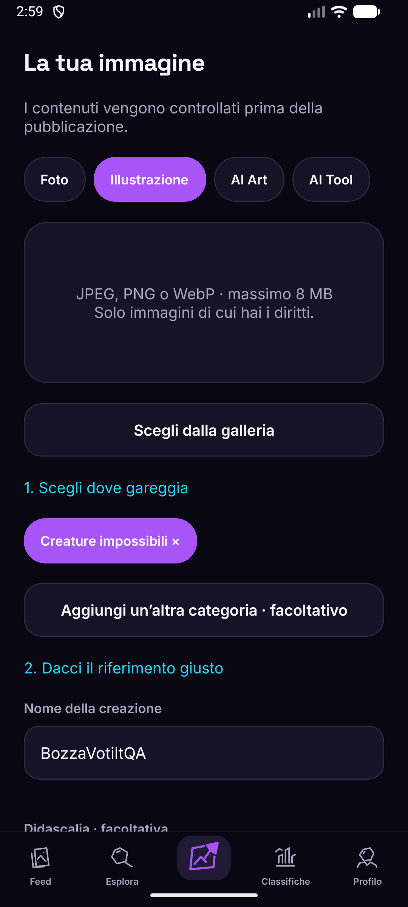
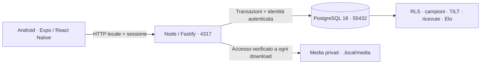

<p align="center">
  
</p>

<h1 align="center">VOTILT</h1>

<p align="center">
  <strong>Un’immagine ti ferma. Un like racconta il tuo gusto. Un TILT lo mette alla prova.</strong><br>
  App Android nativa · Expo / React Native · PostgreSQL locale · Un progetto <strong>antetempo</strong>
</p>

<p align="center">
  <a href="#il-progetto">Il progetto</a> ·
  <a href="#dentro-lapp">Screenshot</a> ·
  <a href="#primo-avvio">Primo avvio</a> ·
  <a href="#sviluppo">Sviluppo</a> ·
  <a href="#test-e-prove">Test</a> ·
  <a href="#documentazione">Documentazione</a>
</p>

> **Stato: demo locale Android.** Sorgenti nel repository privato [antetempo/votilt](https://github.com/antetempo/votilt), commit iniziale [`a0d85bf`](https://github.com/antetempo/votilt/commit/a0d85bf7240beb73f18406b99ed494a167984816). Backend e database girano sul PC. Nessun deploy applicativo o rilascio store; Docker escluso.

## Il progetto

VOTILT è un social game visuale in italiano, pensato per adulti: scopri immagini, costruisci le tue preferenze per categoria e confrontale con quelle degli amici che hanno scelto di condividerle.

Il feed mette al centro il contenuto. Scorrere non assegna voti: un **like** sceglie il tuo preferito in una categoria. Se ti piace un’altra immagine della stessa categoria, entra in scena **TILT**: due carte animate, una scelta. Il risultato aggiorna la tua preferenza e le classifiche attraverso il server.

### Come funziona un TILT

| 01 · Scopri | 02 · Scegli | 03 · Vai in TILT |
|---|---|---|
| Scorri il feed o esplora una categoria. | Il primo like diventa il tuo campione nella categoria. | Un nuovo like nella stessa categoria apre il confronto: tocca una delle due immagini. |

Hai **un solo campione per categoria foglia**. Puoi confermarlo o sostituirlo; X e Indietro annullano il confronto. La conferma arriva dopo il salvataggio del server, anche quando ripeti un tocco o riprendi un’operazione interrotta.

## Dentro l’app

<table>
  <tr>
    <th width="33%">Feed immersivo</th>
    <th width="33%">TILT dinamico</th>
    <th width="33%">Esplora</th>
  </tr>
  <tr>
    <td><a href="docs/media/feed.png"></a></td>
    <td><a href="docs/media/tilt.png"></a></td>
    <td><a href="docs/media/explore.png"></a></td>
  </tr>
  <tr>
    <td>Immagini protagoniste, descrizione autore espandibile e navigazione essenziale.</td>
    <td>Prospettiva 3D, movimento nativo e scelta diretta sull’immagine.</td>
    <td>Ricerca per nome, sito o categoria; arte e tool AI nello stesso motore di preferenze.</td>
  </tr>
</table>

Schermate reali catturate dall’emulatore Android nel collaudo del **6 novembre 2026**, con Classifiche aggiornata e ricollaudata l’**8 novembre**. Le immagini sintetiche mostrate appartengono al catalogo AI dichiarato. [Video originale del TILT](docs/media/tilt-motion.mp4) · [Manifesto e provenienza delle immagini del README](docs/media/manifest.json).

### Cosa puoi fare

| Area | Esperienza |
|---|---|
| **Feed** | Per te, Seguiti e Scopri; scorrimento verticale, like e dettaglio del contenuto. |
| **Esplora** | Catalogo gerarchico, ricerca di nomi e riferimenti, AI Universe con AI Art e AI Tools. |
| **TILT** | Confronto tra il tuo campione e uno sfidante della stessa categoria; scelta, annullamento e retry sicuro. |
| **Classifiche** | Immagini al primo posto, ricerca diretta delle foglie e classifica aperta subito. Toccando una riga scorri le immagini dall’elemento scelto, nell’ordine Like/Duelli/Trend selezionato. |
| **Social** | Profili, follow, amicizie, Taste Match, Friends Battle e notifiche in-app. Amicizia e consenso al confronto sono distinti. |
| **Pubblica** | Simbolo centrale nella barra; caricamento JPEG/PNG/WebP fino a 8 MB, categoria, nome e riferimento richiesto. |
| **Moderazione** | Revisione dei contenuti e delle categorie, segnalazioni, blocco, ripristino e sospensione secondo i permessi. |
| **Privacy** | Visibilità dei campioni, consenso al confronto, gestione dei propri contenuti e cancellazione account. |

<details>
<summary><strong>Guarda anche classifiche e pubblicazione</strong></summary>

<table>
  <tr><th width="50%">Le immagini al primo posto</th><th width="50%">Prepara un contenuto</th></tr>
  <tr>
    <td align="center"></td>
    <td align="center"></td>
  </tr>
</table>

Una proposta di categoria viene controllata per testo e duplicati, poi sottoposta a revisione. Tornando alla categoria suggerita, la bozza resta disponibile. La schermata di pubblicazione contiene dati fittizi di collaudo.

</details>

La barra inferiore rimane disponibile anche nelle schermate di categoria, immagini, segnalazione, impostazioni e TILT. Lo scorrimento usa gli stessi simboli del feed: cuore per il like, share per condividere, altre opzioni per segnalare o gestire il proprio contenuto. Non ci sono selettori aggiuntivi Immagini/Classifica.

### Identità visiva

**Dark Neon**: fondo `#090711`, viola `#A855F7`, ciano `#22D3EE` e rosa `#FF4DA6`. Space Grotesk e Inter inclusi nell’app, 23 pittogrammi originali, target di tocco da 48 dp e supporto al movimento ridotto. Il simbolo centrale serve a pubblicare; TILT si apre dal flusso del like.

[Brandbook PDF](docs/VOTILT-Brandbook.pdf) · [Brandbook HTML da aprire nel browser](docs/brandbook.html) · [Regole del brand](docs/BRANDBOOK.md) · [Design system](docs/DESIGN_SYSTEM.md)

## Primo avvio

La procedura seguente è per **Windows e PowerShell**, ambiente verificato del progetto. Da un clone servono prima il setup locale e poi la build: **l’APK e i dati privati non sono inclusi in Git**.

### 1. Prepara il PC

| Prerequisito | Configurazione usata nel collaudo |
|---|---|
| Git e accesso GitHub | Account con accesso al repository privato. |
| Node.js e npm | Node 24.14.0, npm 11.9.0; dipendenze fissate da `package-lock.json`. |
| PostgreSQL nativo | PostgreSQL 18, binari in `C:\Program Files\PostgreSQL\18\bin`. |
| Android Studio e JDK | JDK 21 incluso in Android Studio; Android SDK e Platform Tools. |
| SDK di compilazione | Piattaforme Android 36 e 37; la piattaforma 36 è usata anche dal lettore UI dei test. |
| Build nativa Windows | CMake 3.31.6 con Ninja 1.12.1, configurazione usata per i percorsi nativi lunghi. |
| Dispositivo | AVD `Medium_Phone_API_36.1`, oppure Android USB con debug autorizzato. Le prove registrate sono su emulatore. |

Le dipendenze npm e Android richiedono Internet durante il setup/build. Una volta preparata, la demo standalone usa il backend del PC e non richiede Internet pubblico, account Google o servizi cloud.

Gli script usano questi percorsi di default; se il tuo SDK o JDK sono altrove, impostali nella PowerShell corrente:

```powershell
$env:ANDROID_HOME = "$env:LOCALAPPDATA\Android\Sdk"
$env:JAVA_HOME = "C:\Program Files\Android\Android Studio\jbr"
# Solo se PostgreSQL è installato in un percorso diverso:
# $env:VOTILT_PG_BIN = "D:\PostgreSQL\18\bin"
```

### 2. Clona e prepara dati e media

```powershell
git clone https://github.com/antetempo/votilt.git
Set-Location votilt
npm ci
npm run db:init
npm run db:start
npm run db:migrate
npm run seed
```

Il setup crea un **cluster PostgreSQL dedicato** in `.local/postgres` sulla porta **55432**. Non utilizza il servizio PostgreSQL eventualmente presente su 5432. Configurazione, credenziali e media privati restano in `.local/`, esclusa da Git. Migrazioni e seed possono essere ripetuti; il seed conserva credenziali e preferenze esistenti.

Il catalogo base comprende **41 categorie foglia e 123 candidati distinti**: 111 immagini AI dichiarate e 12 copertine originali per tool. Comprende anche sei utenti fittizi e contenuti negli stati di moderazione. Il seed prepara gli asset locali inclusi nel progetto; non chiama un generatore AI remoto.

### 3. Avvia il backend

In un terminale dedicato, dalla radice del progetto:

```powershell
npm run api
```

Lascialo aperto. In un’altra PowerShell verifica la connessione:

```powershell
Invoke-RestMethod http://127.0.0.1:4317/health
```

| Risorsa | Indirizzo |
|---|---|
| API dal PC | `http://127.0.0.1:4317` |
| Database demo | `127.0.0.1:55432` · `votilt` |
| Database integrazione | Stesso cluster dedicato · `votilt_test` |
| Database bootstrap | Stesso cluster dedicato · `votilt_bootstrap_test` |

### 4. Genera l’APK standalone

Avvia l’emulatore da Android Studio → Device Manager, oppure collega un dispositivo USB e autorizza il debug. Poi:

```powershell
node scripts/package-android.mjs
```

Lo script genera la directory nativa Android, compila con Gradle e produce:

- `output/VOTILT-local-demo.apk`: APK autonomo per **arm64-v8a e x86_64**, con firma debug locale.
- `output/build-info.json`: data, versione, dimensione e SHA-256 dell’ultima build locale.

`output/build-info.json` presente nel clone descrive la build storica: non implica che l’APK sia incluso. La nuova build aggiorna il file. La directory `/android/` è generata da Expo e resta esclusa da Git.

### 5. Installa e apri l’app

Esegui dalla radice, con **un solo dispositivo pronto**:

```powershell
$votiltAdb = Join-Path $env:LOCALAPPDATA "Android\Sdk\platform-tools\adb.exe"
# Se usi ANDROID_HOME personalizzato:
if ($env:ANDROID_HOME) { $votiltAdb = Join-Path $env:ANDROID_HOME "platform-tools\adb.exe" }
& $votiltAdb devices
& $votiltAdb reverse tcp:4317 tcp:4317
& $votiltAdb install -r .\output\VOTILT-local-demo.apk
& $votiltAdb shell am start -n com.antetempo.votilt/.MainActivity
```

L’APK standalone punta a `127.0.0.1:4317` sul dispositivo. **`adb reverse` collega quella porta al backend sul PC**: funziona con l’emulatore e con il telefono USB. Riapplicalo dopo una riconnessione o un riavvio. Metro non serve per questa modalità; il backend deve restare attivo per login, voti e altre operazioni online.

### 6. Accedi e prova il primo TILT

Apri localmente **`.local/demo-credentials.json`** per copiare email e password, senza pubblicare il file o i suoi valori.

| Account fittizio | Uso |
|---|---|
| **Nova** e **Milo** | Percorsi interattivi; sono già amici e hanno consentito il confronto. |
| **Zora**, **Elio**, **Cleo** | Altri profili e contenuti del catalogo demo. |
| **Team VOTILT** · `mod_votilt` | Revisione contenuti e funzioni da moderatore. |

Puoi anche registrare un account normale dall’app; la registrazione non concede privilegi da moderatore.

1. Accedi con Nova e apri una categoria da Esplora.
2. Metti like a un’immagine. Se non avevi un campione in quella categoria, diventa il primo.
3. Metti like a un’altra immagine della **stessa categoria**: si apre TILT.
4. Tocca una carta per scegliere, oppure X per annullare. Controlla poi la classifica della categoria.
5. Per provare la pubblicazione, usa il simbolo centrale e completa i metadati richiesti. Il contenuto entra in revisione; Team VOTILT può approvarlo.

## Sviluppo

La build di sviluppo usa Metro e il client Expo personalizzato. Prepara prima backend e DB come sopra.

**Terminale Metro:**

```powershell
npm run dev -- --localhost --port 8081
```

**Altro terminale, emulatore avviato:**

```powershell
npm run android
```

La configurazione di sviluppo usa `http://10.0.2.2:4317`, alias del PC nell’emulatore Android. Per lo sviluppo su telefono USB usa `EXPO_PUBLIC_API_URL=http://127.0.0.1:4317` nel terminale Metro e inoltra via ADB sia `4317` sia `8081`. Riavvia Metro dopo aver cambiato l’URL. Non inserire segreti nelle variabili `EXPO_PUBLIC_*`: finiscono nel bundle mobile.

La build standalone forza il suo URL locale nello script di packaging; cambiare l’URL di Metro non cambia un APK già compilato. Il target verificato è Android: la presenza della configurazione iOS non equivale a un collaudo iOS.

### Architettura



| Livello | Tecnologie e responsabilità |
|---|---|
| Mobile | Expo 58, React Native 0.88, TypeScript, Expo Router, Reanimated, TanStack Query, Zustand, Zod. |
| Backend | Node 24, Fastify 5, `pg`, autenticazione email/password con scrypt, sessioni opache revocabili. |
| Persistenza | PostgreSQL 18 nativo, vincoli, RLS e funzioni transazionali. Il server decide esiti e permessi. |
| Media | File privati, validazione dei byte, normalizzazione con sharp e rimozione EXIF. |
| Collaudo | Jest / Testing Library, HTTP e PostgreSQL reali, ADB e UI Automator su Android. |

Il motore mantiene uno slot per utente/foglia. Le operazioni hanno ID e ricevute idempotenti; i retry non duplicano il supporto o l’Elo. Il protocollo di lock è condiviso con moderazione, blocco e cancellazione. I like attivi, l’Elo e il trend sono metriche distinte. La lettura offline usa una cache legata alla sessione; i voti offline non vengono accodati automaticamente.

### Mappa del repository

```text
app/                  Route e navigazione Expo Router
src/                  Feature, componenti, contratti, stato e brand
server/               HTTP, autenticazione, accesso DB e funzioni SQL
schema.sql            Snapshot canonico completo del database
migrations/           Migrazioni e snapshot idempotenti
scripts/              Setup locale, seed, build, audit e driver Android
assets/               Icone originali, artwork, catalogo e manifesti
tests/                Test unitari, componenti e integrazione
docs/                 Specifiche, architettura, guide, prove e immagini README
memory-bank/          Contesto corrente, decisioni e sessioni consolidate
output/               Metadati di build; APK solo locale e ignorato
.local/               DB, configurazione, credenziali e media privati — ignorata
```

## Test e prove

**Regressione eseguita l’8 novembre 2026:** typecheck, lint e formattazione PASS; **106 test unit/componenti in 17 suite e 46 integrazioni HTTP/PostgreSQL PASS**. Audit asset: 123 hash distinti, formato 800 × 1200 e nessun EXIF. I **31 controlli Android** storici risalgono al 6 novembre: includono prove di fasi diverse, non una nuova esecuzione completa dopo ogni modifica. La revisione delle classifiche ha un [report Android dedicato](docs/evidence/android-rankings-results.json).

| Verifica | Comando |
|---|---|
| Regressione completa host | `npm run verify:all` |
| Solo unit/componenti | `npm test` |
| Solo integrazione HTTP/PG | `npm run test:integration` |
| Diagnostica ambiente, dispositivo e API | `npm run doctor` |
| Feed, like, classifiche, proposte categorie sull’APK | `npm run test:e2e` |
| TILT dinamico | `node scripts/android-tilt-e2e.mjs` |
| Anteprime dei primi posti e ricerca diretta delle foglie | `node scripts/android-rankings-e2e.mjs` |
| Classifica diretta, scorrimento e barra persistente | `node scripts/android-navigation-e2e.mjs` |
| TILT piccolo schermo/font e movimento ridotto | `node scripts/android-tilt-accessibility-e2e.mjs` |
| Upload, revisione e voto di un secondo utente | `node scripts/android-creator-e2e.mjs` |
| Social e confronto consensuale | `node scripts/android-social-e2e.mjs` |
| Integrità e provenienza del catalogo | `node scripts/audit-assets.mjs` |

Le integrazioni usano **`votilt_test`**, separato dalla demo. I percorsi Android richiedono backend, dati demo e un dispositivo pronto; interagiscono con account fittizi e possono cambiarne le preferenze. Il percorso `test:e2e` installa l’APK standalone; i driver creator/social storici usano anche il client di sviluppo: consultarne i prerequisiti prima di eseguirli.

I report JSON sono in [`docs/evidence/`](docs/evidence/). Le acquisizioni Android grezze restano locali in `docs/evidence/android/`; la selezione verificata per GitHub è in [`docs/media/`](docs/media/). [Rapporto prove](docs/TEST_REPORT.md) · [Matrice di accettazione](docs/ACCEPTANCE_MATRIX.md).

## Gestione quotidiana

| Operazione | Procedura |
|---|---|
| Riprendere la demo | `npm run db:start`, poi `npm run api`; dispositivo pronto e `adb reverse` attivo. Non serve ricompilare l’APK se non cambia il codice. |
| Fermare l’API | Ctrl+C nel suo terminale. |
| Fermare il solo DB VOTILT | `npm run db:stop`. Il servizio PostgreSQL esterno al progetto non viene toccato. |
| Snapshot del trend | `node scripts/snapshot.mjs`: uno snapshot UTC al giorno, senza riscrivere quello esistente. |
| Backup locale | Ferma API e cluster VOTILT, poi copia `.local/` in una destinazione privata protetta: contiene anche segreti e media. |
| Aggiornare schema e seed | Usa gli script e la [checklist DB](memory-bank/deep/deploy-checklist.md). DDL/seed/backfill richiedono schema, migrazione idempotente ed evidenze coerenti. |

Non è installata un’automazione per gli snapshot. Il trend mostra **“Dati in accumulo”** finché manca lo storico richiesto: il seed non inventa dati dei giorni precedenti. `npm run db:reset:local` è intenzionalmente bloccato; non cancellare `.local/` per risolvere un problema di avvio.

### Problemi comuni

| Sintomo | Controllo e soluzione |
|---|---|
| Login o feed non raggiungono il server | Prova `/health` dal PC; avvia DB/API e riapplica `adb reverse tcp:4317 tcp:4317` per l’APK standalone. |
| APK assente dopo il clone | È previsto: esegui `node scripts/package-android.mjs` prima di installarlo. |
| `adb` non trovato | Usa il percorso completo mostrato sopra o configura `ANDROID_HOME`. |
| Dispositivo `unauthorized` | Sblocca il telefono e approva la richiesta di debug USB. |
| Più dispositivi collegati | Seleziona un solo dispositivo per gli script; nei comandi manuali puoi usare `adb -s <seriale> ...`. |
| Binari PostgreSQL non trovati | Installa PostgreSQL 18 nativo o imposta `VOTILT_PG_BIN`; non usare il DB di un altro progetto. |
| Build nativa fallita su percorsi lunghi | Verifica JDK 21 e CMake 3.31.6/Ninja 1.12.1 in Android Studio; preferisci un checkout breve, per esempio `C:\APP\AI\VOTILT`. |
| Emulatore vede l’API, telefono no | `10.0.2.2` vale per l’emulatore; standalone/telefono USB usano localhost e inoltro ADB. |
| Trend senza dati | Esegui gli snapshot nei giorni d’uso e attendi uno storico reale sufficiente. |
| Credenziali demo non disponibili | Controlla il file locale generato dal seed. Non resettare password e non sostituire credenziali esistenti. |
| Quiz Real or AI? disattivato | È intenzionale: serve un dataset REAL con provenienza verificata. |

## Provenienza, privacy e limiti

Ogni contenuto richiede categoria, nome e riferimento fondamentale: per una persona il nome; per un sito/tool anche il link. Il server valida ogni associazione, fino a tre categorie. I personaggi e i luoghi sintetici del catalogo sono esempi immaginari. [Manifesto del catalogo](assets/seed-media/manifest.json) · [Metadati](docs/CONTENT_METADATA.md) · [Moderazione categorie](docs/CATEGORY_MODERATION.md).

La demo include controllo permessi sul server, storage privato, SecureStore sul dispositivo, RLS, rate limit e moderazione. Le dichiarazioni di maggiore età, diritti e consenso non equivalgono a una verifica certa dell’identità. Non esporre l’API HTTP locale su Internet.

**Prima di distribuire fuori dal PC** restano firma release e HTTPS, gestione segreti, backup/restore, politiche e moderazione continuativa, verifica dipendenze, prove su telefoni fisici e TalkBack completo. FPS, memoria e throughput non sono stati misurati. Recupero password via email e notifiche push non sono configurati; il quiz pubblico resta disabilitato finché mancano fotografie REAL documentate. [Readiness](docs/RELEASE_READINESS.md) · [Problemi noti](docs/KNOWN_ISSUES.md) · [Sicurezza](docs/SECURITY.md).

## Documentazione

| Per approfondire | Documento |
|---|---|
| Requisiti e decisioni | [Specifica originale](docs/SPECIFICA_ORIGINALE.md), [decisioni](docs/DECISIONS.md), [avanzamento](docs/PROGRESS.md) |
| Piani verificati | [Implementazione](docs/votilt-plan.md), [revisione prodotto](docs/votilt-refinement-plan.md), [TILT dinamico](docs/votilt-tilt-plan.md) |
| Backend | [Architettura](docs/ARCHITECTURE.md), [API](docs/API.md), [modello dati](docs/DATA_MODEL.md), [stack](docs/TECH_STACK.md) |
| Contenuti | [Asset e provenienza](docs/SEED_ASSETS.md), [metadati](docs/CONTENT_METADATA.md), [categorie](docs/CATEGORY_MODERATION.md) |
| Qualità e rilascio | [Test report](docs/TEST_REPORT.md), [accettazione](docs/ACCEPTANCE_MATRIX.md), [readiness](docs/RELEASE_READINESS.md) |
| Ripresa del lavoro | [Contesto corrente](memory-bank/activeContext.md), [cronologia](memory-bank/progress.md) |

Le decisioni successive dell’utente prevalgono sulla specifica originale: **Android nativo, PostgreSQL locale e niente Docker**. Il repository è privato; non è dichiarata una licenza open source.

---

<p align="center"><strong>VOTILT · antetempo</strong><br>Scrolla. Scegli. Vai in TILT.</p>
