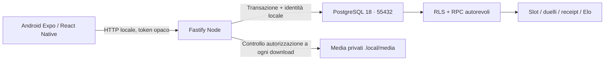

# Architettura

Il server deriva l'identità dalla sessione, mai da userId forniti come identità dal client. Il pool apre una transazione e imposta `app.user_id` solo per quella transazione. Il ruolo API non è proprietario, non bypassa RLS, non legge credenziali. Le funzioni interne non sono eseguibili direttamente dal ruolo API.

Una PK utente/foglia identifica lo slot. Intent e resolve usano operation ID persistiti sul dispositivo, fingerprint del payload e ricevuta server. Il secondo candidato apre un duello sulla versione corrente; soltanto resolve trasferisce il supporto. Lock condivisi con blocco, moderazione e cancellazione rendono atomica l'invalidazione. Elo è separato dal numero di campioni, K=32, iniziale 1500, cooldown 24 ore per utente/foglia/coppia non ordinata.

TanStack Query gestisce letture e invalidazione. Il feed è virtualizzato, paginato e precarica il prossimo media; il campionatore seeded usa interessi, novità e scoperta. La cache locale di lettura è legata all'hash della sessione, scade dopo 24 ore e viene eliminata insieme alle immagini al logout/cambio account. Non esiste una coda automatica dei voti offline.

I confini applicativi usano Zod: input HTTP, principali risposte mobile, sessione e snapshot cache. Upload controllati sui byte, ridimensionati e ricodificati eliminando EXIF. I link di riferimento non vengono scaricati dal server.

Debito locale: lock globale transazionale conservativo e ranking aggregato. Misurare contesa/throughput prima di introdurre lock granulari o viste materializzate. Nessuna pretesa di scalabilità o 60 FPS senza misura.
