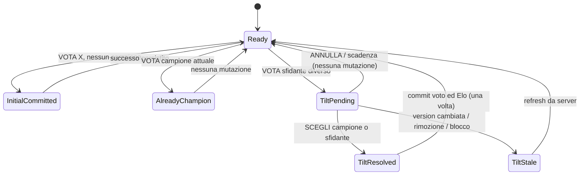

# VOTILT — SPECIFICA MASTER COMPLETA PER CODEX

> **Da condividere integralmente con lo sviluppatore e fornire a Codex come capitolato implementativo.** Questa specifica comprende implementazione mobile Android, architettura locale, motore TILT transazionale, classifiche, AI Universe, social, sicurezza, dataset demo, setup Windows e criteri di accettazione.
>
> **Scelta di prodotto:** Social completo, stile Dark Neon, test interamente locale su Windows. Codex deve implementare per milestone e non dichiarare completato nulla che non abbia verificato.

> **Documento operativo da consegnare integralmente a Codex.**
>
> Prodotto: **VOTILT** · Tagline: **Scrolla. Scegli. Vai in TILT.** · Interfaccia: italiano · Design: **Dark Neon** · Target eseguibile: **Android su emulatore Windows** · Architettura: app mobile + backend *solo di sviluppo* locale · Nessun cloud e nessuna API AI a pagamento obbligatoria.
>
> **Istruzione primaria per Codex:** questo documento è un contratto di costruzione e di collaudo, NON una richiesta di documentare una proposta. Devi scrivere, eseguire e verificare codice. Non dichiarare riuscito alcun test che non hai realmente eseguito. Se il runtime non permette Android Studio, Docker o l'emulatore, verifica il massimo possibile e annota precisamente il blocco con i comandi che l'utente dovrà eseguire.

---

## 0. Mandato, autonomia e definizione di successo

Agisci contemporaneamente come **product lead, UX engineer, senior React Native engineer, PostgreSQL architect, security engineer e QA lead**. Realizza una repository funzionante senza richiedere un'approvazione a ogni passo. Non fermarti dopo il piano; passa ai file e al codice. Se trovi repository già esistente, leggilo e preservalo; non resettare, spostare o eliminare modifiche dell'utente per convenienza. Se il repository è vuoto, inizializzalo.

### Vincoli non negoziabili

1. **Prodotto solo mobile.** Non creare una PWA, un sito o una web app sostitutiva. L'unico front-end consumer è React Native. Supabase Studio o strumenti browser locali possono essere usati esclusivamente per sviluppo/debug.
2. **Funzionamento multiutente reale** con backend sul PC: l'app mobile non deve simulare gli utenti con array in memoria o classifiche inventate. I dati demo devono vivere nel database e usare gli stessi flussi del prodotto.
3. **Costo obbligatorio zero.** Dipendenze open source e gratuite. No cloud Supabase obbligatorio; no OpenAI, Anthropic, Firebase, servizi di push o pagamento. Connessione Internet consentita unicamente per scaricare strumenti e dipendenze nella fase di setup. In seguito le funzionalità core devono poter funzionare nella LAN di sviluppo senza Internet pubblico.
4. **Niente finzioni:** nessun pulsante morto, successo finto, ranking hardcoded, AI detector inventato, autenticazione finta, “TODO” nascosti o benchmark non misurati.
5. **Scrivere test veri** per logica di business, sicurezza, concorrenza e percorsi utente. Ripetere i test e salvare prove in `docs/TEST_REPORT.md`.
6. **Privacy by design.** Solo partecipanti adulti; foto di persone soltanto con diritti e consenso di pubblicazione dichiarati e verificabili nel flusso. Non implementare classifiche degradanti basate su caratteristiche protette. In demo usare illustrazioni/asset originali oppure correttamente licenziati e documentati. Filtri, segnalazioni, blocco, cancellazione contenuti e moderazione sono funzioni necessarie, non optional.
7. **Una categoria = un campione attivo per utente**, indipendentemente da quante foto vengano scorse o votate in altre categorie.
8. **Nessuna app separata per moderatori:** area moderazione è all'interno dell'app, visibile e utilizzabile solo da ruoli autorizzati dal server.
9. **Prima robustezza del motore TILT, poi ampiezza social.** Le feature social possono essere sviluppate a milestone ma l'ambito finale richiesto è “Social completo” come definito qui.
10. **Nessuna pubblicazione store** e nessun servizio production-grade richiesto in questo incarico. Predisporre architettura estendibile ma NON dichiarare pronto al rilascio pubblico il sistema locale, privo di infrastruttura di moderazione operativa e hardening.

### Definition of Done generale

Una funzione è `DONE` soltanto se: (a) esiste nel codice, (b) utilizza stato dati persistente corretto, (c) comprende stati loading/empty/error, (d) implementa le regole di autorizzazione, (e) supera test pertinenti e (f) può essere riprodotta seguendo il README. Se non soddisfa queste condizioni, segnala `PARTIAL` o `BLOCKED` senza ambiguità.

---

## 1. Posizionamento e esperienza desiderata

**Idea:** un social-game di preferenze visive. Lo swipe introduce candidati. In ciascuna categoria profondamente specifica l'utente può incoronare **un solo campione personale**. Ogni volta che vuole votare un concorrente nella stessa categoria, l'app entra in **TILT MODE** e mostra due contendenti uno accanto all'altro. L'utente deve scegliere chi conserva il trono. La società degli utenti contribuisce contemporaneamente a classifiche globali per preferenze attive e a una graduatoria indipendente della forza nei duelli.

**Promessa al pubblico:** “Scopri cosa ti piace davvero. Difendi i tuoi campioni. Sfida gli amici.”

**Tre motivi per tornare:** candidati nuovi nel feed, il **TILT del giorno**, confronto/divergenza con gli amici. Non introdurre ricompense manipolatorie o urgenza artificiale.

**Personas testabili:**
- Utente nuovo: sceglie 3 interessi e capisce il primo voto entro 10–15 s di uso, senza tutorial lungo.
- Utente assiduo: ha 30 campioni; la parte divertente è sfidarli senza dover rivedere 30 categorie da capo.
- Creatore: pubblica contenuti originali, ne vede stato di moderazione, presenza in ranking e report essenziali.
- Gruppo amici: segue/accetta amicizie, condivide categoria e confronta campioni diversi.
- Moderatore: vede segnalazioni, decide e conserva motivazioni/audit.

**Anti-goal:** no messaggistica privata, no live stream, no video UGC, no feed di gossip, no pagamento, no NFT, no riconoscimento facciale, no predizione tratti/psicometria dai gusti; non raccogliere geolocalizzazione, contatti di rubrica o dati biometrici.

---

## 2. Stack tecnico, versioni e regole di compatibilità

### Stack obbligatorio

| Layer | Scelta | Note vincolanti |
|---|---|---|
| Client mobile | React Native, Expo, TypeScript `strict` | App nativa Android; codice iOS-portable ma test iOS non richiesti su Windows |
| Routing | Expo Router | Gruppi `(auth)`, `(tabs)`, stack modal/detail |
| UI/animazioni | React Native core, Reanimated, Gesture Handler | Usare soltanto release compatibili con SDK scelto; target fluido su emulatore |
| Rendering media | `expo-image`, `expo-image-picker`, `expo-file-system` se necessario | Cache, placeholder, resize e dimensioni verificate |
| Interazioni | `expo-haptics`, `expo-linear-gradient`, icone compatibili | `reduceMotion` e disabilitazione feedback rispettati |
| Remote state | TanStack Query | Query keys canoniche, invalidazione dopo mutation, no doppia source of truth |
| UI state | Zustand | Tab, filtri, UI overlay, drafts; mai fonte definitiva dei voti |
| Forms | React Hook Form + Zod (o equivalente motivato) | Condivisione schemi di validazione, no fiducia nel client |
| Backend locale | Supabase CLI, PostgreSQL, Auth, Storage | Docker Desktop/WSL2 su Windows; SQL migrations e seed deterministici |
| Sessione | `@supabase/supabase-js` + AsyncStorage | Gestione `AppState`, refresh token e logout realmente testati |
| Test | Jest + React Native Testing Library; test DB SQL/RPC; Maestro se possibile | E2E Android locale, prove video/screenshots se ambiente disponibile |
| Quality | ESLint, Prettier, typecheck, `expo-doctor`, test command | Configurazioni riproducibili |

**NON fissare a priori numeri di versione che potrebbero essere già superati.** Prima controlla versioni stabili e compatibili su documentazione ufficiale. Usa `npx expo install` per pacchetti gestiti da Expo, `npx expo install --check` / `npx expo-doctor` e salva **versioni realmente installate** in lockfile e `docs/TECH_STACK.md`. Non usare pacchetti deprecati solo perché citati da vecchi tutorial.

### Requisiti PC Windows per esecuzione

- Windows 10/11 64-bit con virtualizzazione abilitata, Node.js LTS, Git, Android Studio + SDK/Platform Tools + AVD, JDK richiesto dalla release Expo/Gradle selezionata, Docker Desktop e WSL2 funzionante.
- Android Emulator `adb devices` deve mostrare almeno un dispositivo pronto; i comandi non devono supporre che `ANDROID_HOME`, `JAVA_HOME` o SDK siano già configurati.
- `npx expo run:android` compila e installa una build locale, **non** usa EAS cloud; per sole modifiche JS successive è sufficiente `npx expo start` con client compilato.
- La CLI locale Supabase parte con `npx supabase start` e le migrazioni si ricostruiscono con `npx supabase db reset` (**distruttivo soltanto per il DB locale**; avvisa chiaramente).
- Il client nell'emulatore raggiunge tipicamente l'host Windows via `http://10.0.2.2:54321` mentre i comandi host usano `http://127.0.0.1:54321`. Verifica le porte *effettivamente* emesse da `npx supabase status`; non hardcodare credenziali non verificate.
- Per dispositivo fisico eventuale, prevedi configurazione LAN esplicita e restrittiva; non esporre Supabase locale pubblicamente. Il test principale rimane **emulatore Android**.
- Se Android blocca HTTP cleartext, configura permesso **solo in sviluppo**. Non sacrificare la sicurezza release per aggirare problemi di test.
- Le variabili `EXPO_PUBLIC_*` sono pubbliche nel bundle: solo endpoint e chiave publishable/anon consentiti; vietate chiavi service-role/secret.
- I file `storage` devono salvare `bucket` e `object_path`, non URL con `127.0.0.1`; il resolver costruisce l'indirizzo dal client in uso, gestendo eventuali signed URL privati.

### Scripts nel `package.json`

Prevedi realmente, senza riferimenti a file inesistenti: `dev`, `android`, `typecheck`, `lint`, `format:check`, `test`, `test:unit`, `test:integration`, `test:e2e` (se tool disponibile), `db:start`, `db:stop`, `db:reset:local`, `db:types`, `seed:media`, `doctor`, `verify:all`. Se qualche script ha prerequisiti di sistema non presenti, deve restituire un errore comprensibile e descrivere come risolverlo.

---

## 3. Architettura di riferimento e responsabilità

```text
[Android Expo App]             (nessuna web app)
   | Auth/session + Query
   | feed paging / immagini / profile
   | RPC vote_intent / resolve_tilt / admin decisions
   v
[Supabase Local API Gateway]
   |---------- [Auth]
   |---------- [Storage] private pending / public approved
   |---------- [PostgreSQL]
                       | tables + RLS
                       | constrained transactional RPCs
                       | deterministic ranking queries
                       | audit / events

[Node scripts locali] ----> seed demo / media / integration assertions
[Android emulator] -----> app / E2E tests
```

Monorepo pragmatico, **un unico progetto** se non ci sono motivi di frazionare. Struttura suggerita:

```text
VOTILT/
├─ app/                       # route components Expo Router
│  ├─ _layout.tsx
│  ├─ (auth)/                  # login, signup, onboarding
│  ├─ (tabs)/                  # feed, explore, tilt, ranking, profile
│  ├─ category/[categoryId].tsx
│  ├─ content/[contentId].tsx
│  ├─ duel/[duelId].tsx
│  ├─ ai-universe/             # art, tools, real-or-ai
│  ├─ friends/                 # richieste, taste match
│  ├─ upload/                  # wizard nuovo contenuto
│  └─ moderation/              # rotte protette
├─ src/
│  ├─ components/{ui,feed,duel,ranking}/
│  ├─ features/{auth,feed,categories,voting,rankings,social,uploads,ai,moderation,notifications}/
│  ├─ lib/{supabase,env,query-client,logger,storage,errors}/
│  ├─ theme/{tokens,typography,spacing,motion}/
│  ├─ hooks/
│  ├─ types/{database,domain}/
│  └─ utils/
├─ supabase/{migrations,seed.sql,config.toml,tests}/
├─ scripts/{seed-users,seed-media,smoke,doctor}/
├─ assets/{icons,illustrations,seed-media}/
├─ tests/{unit,integration,e2e}/
├─ docs/{PROGRESS,ARCHITECTURE,DATA_MODEL,SECURITY,DESIGN_SYSTEM,API,TEST_REPORT,KNOWN_ISSUES,DECISIONS,SEED_ASSETS,RELEASE_READINESS}.md
├─ .env.example
├─ README.md
└─ package.json / lockfile
```

**Regole di separazione**:
- Route component: layout e route params soltanto; feature hooks e UI per comportamento.
- Service layer: chiamate Supabase tipizzate, validazione response, conversione error codes in errori di dominio.
- Domain: funzioni pure per selezione feed, copy, calcolo non-autoritativo di anteprime; **esiti voto e rating solo backend**.
- Backend: vincoli, concorrenza, controllo di permessi, eventi, ranking.
- Config: URL e chiave tramite loader runtime validato; test diversi con config indipendente.
- Scrivere ADR per scelte architetturali non ovvie; evitare un file monolitico da migliaia di righe.

---

## 4. Design system e specifica di interazione

### Identità visiva

- **Nome UI:** VOTILT; preferire wordmark custom testuale originale, senza copiare TikTok.
- **Dark Neon** premium: sfondo `#090711`, surface `#171326`, surface raised `#211A35`, bordo `#34294C`, testo primario `#F8F6FF`, secondario `#A9A3BE`, viola TILT `#A855F7`, cyan `#22D3EE`, magenta `#FF4DA6`, positivo `#4ADE80`, pericolo `#FF647C`.
- Tipografia: font moderno open source (non incorporare file con licenze incompatibili); gerarchia mobile non artificiosamente miniaturizzata.
- Spacing scale 4/8/12/16/24/32; raggi 12/18/24; touch targets **minimo 44–48 dp**; safe area/notch/footer gesture Android.
- Animazioni 180–320 ms per microinterazioni; effetto TILT leggermente più spettacolare, mantenendo input responsivo. Evitare animazioni costose non GPU-friendly e flash stroboscopici.
- Il contenuto è protagonista: feed a schermo immersivo, overlay a contrasto e descrizione leggibile su immagini chiare/scure.
- UI interamente in italiano, tono giovane e spiritoso senza offendere i soggetti. No UX che costringa a votare per continuare a scorrere.
- Accessibilità: screen reader labels, fontScale, contrasto testato, motion reduction, stati non identificati soltanto dal colore, haptic disattivabile.

### Navigation map

**Tab bar fissa (5):**
1. **Feed:** Per te / Seguiti / Esplora, contenuti verticali.
2. **Esplora:** macrotemi, ricerca, categorie, AI Universe, trend, suggerisci categoria.
3. **TILT:** My Champions, storico duelli, Tilt of the Day, Friends Battle.
4. **Classifiche:** ranking filtrato per categoria, Popolari / Duelli / Trend, periodo.
5. **Profilo:** scheda, contenuti, preferenze, follower/amici, impostazioni e privacy.

Rotte stack/modali: registrazione, selezione interessi, dettaglio foto, duello, upload, richiesta amicizia, confronto gusti, Real or AI?, segnalazioni, blocco, cancellazione account, moderazione. Nella navigazione preserva posizione feed tra tab e ritorno da dettaglio, salvo rigenerazione necessaria.

### Matrice di schermate (funzioni e stati)

| Schermata | Controlli autentici | Stati obbligatori |
|---|---|---|
| Splash/Bootstrap | health locale, session restore | initializing, backend offline, session invalid |
| Welcome | esplora demo in sola lettura / accedi | auth required per voti |
| Login/Signup | email/password, password reset locale se supportato, credenziali demo documentate | validation, duplicate email, rejected credentials, mail sandbox |
| Onboarding | scelta >=3 leaf, salva interessi, salta consentito con default esplicito | error retry, saved state |
| Feed | swipe, VOTA, salva categoria, share, profilo autore, report | skeleton, empty, offline, deleted item |
| Categoria | breadcrumb, follow categoria, feed filtrato, ranking, ordinamento | no media, pending no visibility |
| TILT duel | campione/sfidante, scelta A/B, chiudi/annulla, confronto ingrandito | pending, submit lock, stale, expiry, win/lose |
| My Champions | card per foglia, apri categoria, nascondi profilo | zero votes, withdrawn content |
| Classifiche | filtro leaf, metriche e periods reali, posizioni | insufficient votes, refresh, blocked items |
| Esplora | macrotemi, ricerca, trending, AI Universe | no results, filter chips |
| Upload | file chooser, preview crop, caption, tag leaf, attestazione, submit | compression fail, oversized, pending review |
| Social | follow, friend request, accept/reject, block, share battle, match | private/blocked, pending, no common votes |
| Profilo | avatar, bio, contenuti, privacy, logout, delete | private fields hidden |
| Notifiche | read/unread, deep-link, delete notification | stale target gracefully handled |
| Moderazione mobile | queue, approve/reject, report action, audit | forbidden to ordinary users |
| AI Universe | Art Battle, Tools Arena, Real or AI | provenance unknown excluded |

Tutte le pagine devono avere empty states scritti ad hoc, e pulsanti pertinenti che portino a un'azione reale.

### Microcopy richiesta

- Primo voto: `Hai scelto il tuo campione! 👑`
- Voto candidato successivo: `Hai già un campione qui. Si va in TILT! ⚡`
- Apertura duello: `Uno solo resta sul trono.`
- Campione confermato: `Il trono è salvo.`
- Sfidante vince: `Nuovo campione incoronato!`
- Concorrenza: `Il tuo campione è cambiato su un altro dispositivo. Ricarichiamo il duello.`
- Offline: `Il tuo voto non è stato inviato. Riprova quando torni online.`
- Pending upload: `Proposta inviata. Sarà visibile dopo la revisione.`
- Feed vuoto: `Qui è tutto tranquillo… per ora. Esplora altre categorie.`
- Non usare il termine `voto` come se un confronto perso assegnasse comunque un secondo voto attivo.

---

## 5. Tassonomia profonda: modello e contenuti

Categorie come **albero di profondità massima 4**: `MACROTEMA > TEMA > SOTTOTEMA > FOGLIA VOTABILE`. Per evitare ambiguità il motore consente il voto **soltanto sul nodo foglia**. L'utente può seguire macrotema e foglia, ma la preferenza attiva è per la foglia soltanto. Percorso canonico e breadcrumb; slug univoco tra fratelli; nessun ciclo; parent `null` solo per depth=1. Il percorso non deve cambiare arbitrariamente una volta popolato di voti; prevedi redirect/migrazione se si rinomina una categoria.

### Catalogo seed proposto: minimo 40 foglie

| Macrotema | Tema | Sottotema | Foglia votabile |
|---|---|---|---|
| Persone & Vibes | Ritratti | Espressioni | Sguardi dolci |
| Persone & Vibes | Ritratti | Espressioni | Sorrisi contagiosi |
| Persone & Vibes | Ritratti | Fotografia | Ritratti cinematografici |
| Persone & Vibes | Moda | Streetwear | Outfit della serata |
| Persone & Vibes | Moda | Accessori | Occhiali da urlo |
| Persone & Vibes | Espressioni | Ironia | Facce da meme |
| Persone & Vibes | Performance | Cosplay | Cosplay iconici |
| Persone & Vibes | Estetiche | Vintage | Look retro |
| Food & Drink | Pizza | Classici | Margherita perfetta |
| Food & Drink | Pizza | Creative | Pizza impossibile |
| Food & Drink | Street food | Burger | Burger esagerati |
| Food & Drink | Dolci | Cioccolato | Dessert indecenti |
| Food & Drink | Dolci | Pasticceria | Torte spettacolari |
| Food & Drink | Cucina | Impiattamento | Piatti scenografici |
| Food & Drink | Beverage | Analcolici | Drink neon |
| Gaming & Pop | Setup | Luci | RGB estremo |
| Gaming & Pop | Setup | Stanze | Gaming room da sogno |
| Gaming & Pop | Cosplay | Fantasy | Armature leggendarie |
| Gaming & Pop | Pixel art | Ambienti | Mondi retro |
| Gaming & Pop | Meme | Animali | Gatti criminali |
| Gaming & Pop | Meme | Situazioni | Momenti assurdi |
| Travel & Places | Cieli | Tramonti | Tramonti impossibili |
| Travel & Places | Città | Notturne | Neon metropolitani |
| Travel & Places | Natura | Montagne | Viste epiche |
| Travel & Places | Alloggi | Insoliti | Dormire sugli alberi |
| Travel & Places | Natura | Acqua | Spiagge da sogno |
| Design & Creativity | Architettura | Piccole case | Mini case geniali |
| Design & Creativity | Auto | Custom | Auto da film |
| Design & Creativity | Arte | Scultura | Oggetti impossibili |
| Design & Creativity | Fotografia | Macro | Dettagli alieni |
| Design & Creativity | Moda | Scarpe | Sneakers futuristiche |
| AI Universe | AI Art | Cyberpunk | Città del futuro |
| AI Universe | AI Art | Fantasy | Creature impossibili |
| AI Universe | AI Art | Ritratti sintetici | Personaggi immaginari |
| AI Universe | AI Art | Surrealismo | Sogni digitali |
| AI Universe | AI Art | Architettura | Megastrutture futuristiche |
| AI Universe | AI Memes | Assurdo | Meme surreali |
| AI Universe | AI Tools | Coding | Assistenti sviluppo |
| AI Universe | AI Tools | Immagini | Generatori visuali |
| AI Universe | AI Tools | Produttività | Assistenti organizzazione |
| AI Universe | AI Tools | Creatività | Tool musicali AI |

Ogni leaf contiene: titolo, slug, descrizione breve + esempi ammissibili, cover originale, tag di ricerca, `content_policy` locale, numero approvati. Esempi ironici sono categorie su contenuti e stili, **non inviti a classificare persone reali per etnia, sensualità o attributi sensibili**. Ritratto di adulto pubblicato volontariamente ammesso secondo policy.

### Proposte utenti

Wizard `Proponi categoria`: scegli macrotema e percorso esistente, titolo max 60 caratteri, descrizione 80–250, ragione e minimo 3 esempi; fuzzy-search per possibili duplicati. Stato `pending/approved/rejected`, revisione mobile con motivo, audit. La proposta non crea subito una foglia pubblica né abilita voti.

### Contenuti assegnati a più categorie

La stessa foto può essere candidata in massimo 3 foglie **compatibili**, approvate separatamente. Il voto è sempre riferito alla **coppia (utente, foglia)**: se una foto è votata in `Sguardi dolci`, non è automaticamente votata in `Ritratti cinematografici`. Elo e conteggi sono anch'essi distinti per foglia.

---

## 6. Specifica del FEED: ordinamento, swipe, azioni, deduplica

### Comportamento

- Verticale immersivo, un contenuto alla volta, foto/illustrazione a copertura sicura (`cover` o `contain` secondo tipo), overlay: categoria, nickname, badge AI, caption breve, pulsante `VOTA`, dettagli, share, segnala.
- Swipe su/giù cambia contenuto; swipe NON equivale a voto. Un doppio tap per like, se presente, è separato e NON ha impatto sui campioni né ranking. Meglio omettere like nella prima versione per chiarezza.
- Il pulsante `VOTA` opera **nella foglia attualmente mostrata**. Se l'immagine è associata a più categorie, il contesto è esplicito; in dettaglio l'utente può scegliere una foglia prima di votare.
- Dopo primo voto: messaggio di successo e resta nel feed. Dopo voto su altra foto: apri TILT con campione e sfidante e congela avanzamento soltanto nel modal. Chiudere il modal significa **nessun nuovo voto**; il campione resta intatto.
- Feed `Per te` = default; `Seguiti` = autori seguiti (può essere vuoto); `Esplora` = serendipità controllata; feed `Categoria` = solamente foglia specifica.
- `Vota` su contenuto già campione → badge `Già il tuo campione`, nessun secondo voto, nessun TILT e nessun evento ranking incrementale.
- Passaggio tra tab preserva la posizione finché il feed resta valido; refresh manuale genera nuova sessione ordinata.

### Recommender v1 — chiaro e testabile

Non costruire ML senza dati. Usa **weighted sampling deterministico** con seed per sessione:
- 60% dalle foglie seguite o dai macrotemi scelti, 20% contenuti recenti/underexposed, 20% esplorazione cross-category.
- All'interno dei bucket: randomizzazione con PRNG seeded, penalità su item mostrati in ultime 100 impressioni, boost contenuti approvati recenti e sottoesposti, limite consecutivo di contenuti della stessa foglia (`<=3`), escludi blocchi/removed/rejected, penalizza contenuti già visti ma non escluderli per sempre.
- Gestire il caso quando un bucket è vuoto redistribuendo il peso ai restanti. Pagina di 10–15 elementi, `cursor` opaco con seed e offset/last token, niente `ORDER BY random()` su intera tabella a ogni scroll.
- Non ripetere la stessa coppia `(content_id, leaf_id)` entro una sessione finché altre scelte esistono. Precarica 1–2 immagini prossime senza scaricare tutto il database.
- Rating e popolarità non devono “seppellire” nuovi contenuti; almeno una quota di discovery resta riservata a contenuti poco esposti.

### Misure di performance realistiche

- Scroll fluido senza crash, memory pressure sotto controllo usando lista virtualizzata, resize e cache. Non dichiarare 60 FPS se non misurati.
- Placeholder e loading progressivo. `expo-image` con cache controllata; assenza file o media cancellato → fallback + skip logico.
- Registrare impression soltanto dopo visualizzazione significativa (es. >=1 secondo e almeno 50% visibile) e con deduplica `(viewer, content, category, session)`, non a ogni render.
- Offline: mostra cache recente se disponibile, disabilita voto/duello senza server e comunica chiaramente che nessuna preferenza è stata salvata. **Nessuna coda automatica** per voto offline senza una strategia di risoluzione conflitti.

---

---

## 7. Motore di gioco — TILT (specifica formale, NON interpretabile liberamente)

Questo è il **cuore del prodotto**. Progetta, implementa e testa come una macchina a stati con stato autorevole PostgreSQL. L'UI è una rappresentazione dello stato server, non ne decide la validità.

### 7.1 Glossario e invarianti

- `U` = utente autenticato; `C` = categoria foglia pubblicata; `X` = contenuto approvato e collegato a `C`.
- `Champion(U,C)` = contenuto campione attivo dell'utente in quella foglia, oppure `null`.
- `VoteSlot(U,C)` = una e una sola riga per coppia utente/foglia, contenente `champion_content_id` nullable e `version` monotona.
- `TILT duel` = sfida tra campione già esistente (`incumbent`) e candidato (`challenger`); non è un voto addizionale.
- `Vote event` = audit persistente di primo voto, cambio campione, conferma campione o invalidazione da moderazione.

**Invarianti rigorose**:

I1. Per ogni `(user_id, category_id)` esiste al massimo **uno slot** e in esso al massimo **un campione attivo**.

I2. Solo utenti autenticati possono modificare campioni; sessione guest può soltanto leggere contenuti approvati.

I3. `Champion(U,C)` è un contenuto approvato, valido e associato alla foglia `C`, oppure `null`. Se il contenuto viene rimosso, la scelta attiva va invalidata **atomicamente** durante la moderazione e la classifica viene ricalcolata.

I4. Un utente non può votare un contenuto di una foglia diversa, un contenuto pending/rejected/removed o un contenuto di autore da lui bloccato (e viceversa).

I5. Un primo voto elegge immediatamente il campione; se già c'è un campione diverso, nessuna modifica di preferenza avviene **prima** della decisione nel duello.

I6. Un TILT chiuso/annullato/scaduto non cambia la preferenza e non aggiorna Elo.

I7. Se il campione vince, lo slot NON cambia, ma il duello risolto entra nello storico e può aggiornare Elo; se vince lo sfidante, slot cambia e l'ex campione perde il voto attivo.

I8. Una action HTTP ripetuta con lo stesso `client_operation_id` deve produrre **lo stesso risultato**, mai doppie mutazioni, eventi, Elo o notifiche.

I9. Un duello che contiene campione o `slot.version` superati è **stale**; non può risolversi con un vecchio snapshot, anche se entrambi i contenuti esistono.

I10. Il conteggio popolare di una foto in `C` è **il numero di slot attivi** che puntano a quella foto in `C`, non la somma di clic o duelli storici. Nessuna doppia contabilizzazione per categorie multiple.

I11. Le decisioni del duello sono esclusivamente `incumbent` oppure `challenger`; il client non può indicare liberamente un `winner_content_id` fuori dal duello.

I12. Ogni mutazione è nel DB con transazione singola, row-level locking e ritorno tipizzato. Niente sequenza client `SELECT -> UPDATE -> INSERT` non transazionale.

### 7.2 Macchina a stati utente



La macchina a stati della UI distingue `idle`, `submitting_intent`, `tilt_loading`, `tilt_ready`, `resolving`, `resolved`, `stale`, `expired`, `error`. Durante `resolving`, blocca altri tap, mostra progress e un pulsante retry **con lo stesso operation id** se la risposta è incerta.

### 7.3 Contratto RPC #1 — `vote_intent`

**Input tipizzato**:

```typescript
type VoteIntentInput = {
  categoryId: string;         // UUID foglia dal contesto della card
  contentId: string;          // UUID sfidante selezionato
  clientOperationId: string;  // UUID v4 per questa azione
};

type VoteIntentResult =
  | { kind: 'INITIAL_VOTE'; championId: string; slotVersion: number; receiptId: string }
  | { kind: 'ALREADY_CHAMPION'; championId: string; slotVersion: number; receiptId: string }
  | { kind: 'TILT_REQUIRED'; duelId: string; incumbentId: string; challengerId: string;
      categoryId: string; expectedSlotVersion: number; expiresAt: string; receiptId: string };
```

Comportamento atomico:

1. Ottieni `auth.uid()` direttamente dal contesto DB; non accettare `userId` passato dal client.
2. Valida `categoryId` leaf attiva e `contentId` approved, ammesso e collegato a `categoryId`; verifica restrizioni di block tra utente e autore.
3. Verifica idempotency receipt per `(uid, clientOperationId, 'vote_intent')`; se già `completed` restituisci risposta originale, dopo controllo base di ownership.
4. Crea se mancante il `vote_slot` con `INSERT ... ON CONFLICT DO NOTHING` e poi `SELECT ... FOR UPDATE`; questa riga serializza anche il caso dei **due primi voti simultanei**.
5. Se slot senza campione: assegna `contentId`, incrementa `version`, scrivi `vote_event(initial)`, salva receipt e rispondi `INITIAL_VOTE`.
6. Se campione = `contentId`: salva receipt, rispondi `ALREADY_CHAMPION`; non inserire evento/duello e non modificare `version`.
7. Se diverso: marca `superseded` gli altri `pending` per stessa `(uid,C)`, crea sfida `pending` con incumbent/challenger, `expected_slot_version` e scadenza server-side (es. 15 minuti); salva receipt e rispondi `TILT_REQUIRED`. Lo slot **non cambia**.
8. Se campione è già stato ritirato e la normalizzazione è pendente, correggi lo stato tramite transazione/autorizzazione appropriata; non mostrare contenuto rimosso nel duello.

**Nota design:** usare una sola sfida `pending` valida per coppia utente/foglia. Se l'utente apre un altro sfidante, la precedente diventa `superseded`. I duelli scaduti possono essere gestiti lazy su accesso, con job locale facoltativo; il controllo di `expires_at` in risoluzione è sempre obbligatorio.

### 7.4 Contratto RPC #2 — `resolve_tilt`

**Input tipizzato**:

```typescript
type ResolveTiltInput = {
  duelId: string;
  winnerSide: 'INCUMBENT' | 'CHALLENGER';
  clientOperationId: string; // nuovo UUID per questa risoluzione, riusato in ogni retry
};

type ResolveTiltResult = {
  kind: 'TILT_RESOLVED';
  duelId: string;
  categoryId: string;
  winnerContentId: string;
  championContentId: string;
  didChampionChange: boolean;
  slotVersion: number;
  oldPopularityCount?: number; // se calcolabile senza query costose
  newPopularityCount?: number;
  receiptId: string;
};
```

Comportamento atomico:

1. Verifica autenticazione e receipt idempotente per `(uid, clientOperationId, 'resolve_tilt')`. Le duplicate con medesimo ID restituiscono il receipt salvato senza rieseguire Elo.
2. Carica duello e slot nel corretto ordine di lock, incluso `SELECT ... FOR UPDATE` sullo slot. I lock sugli Elo di due contendenti vanno sempre acquisiti in **ordine UUID crescente** per prevenire deadlock. Assicurati che l'ordine fra tutte le RPC critiche sia coerente.
3. Il duello deve appartenere a `uid`, essere `pending`, non scaduto, non `superseded`, con `expected_slot_version == slot.version` e `incumbent == champion` attuale.
4. Verifica nuovamente categoria e contenuti (approved/collegati/non bloccati) proprio al momento della risoluzione.
5. Se vince `INCUMBENT`: non cambiare lo slot; marca il duello `resolved` e registra l'esito storico. NON aggiungere né sottrarre voti popolari.
6. Se vince `CHALLENGER`: modifica il `champion_content_id`, incrementa `slot.version`, registra `vote_event(transfer, old,new)` e marca il duello resolved.
7. Aggiorna i rating Elo di entrambe le foto nella **stessa categoria** come evento **una volta sola**; crea record `rating_event` univoco su `duel_id` o calcola derivazione deterministica. Se Elo fallisce, deve rollbackare anche la risoluzione; mai stato parziale.
8. Marca/supera ogni altro duello ancora pending dello stesso slot; salva receipt e restituisci risposta. Se il client perde la risposta, il retry torna allo stesso receipt.
9. Errori di dominio strutturati: `AUTH_REQUIRED`, `CATEGORY_NOT_LEAF`, `CONTENT_UNAVAILABLE`, `BLOCKED_CONTENT`, `DUEL_NOT_FOUND`, `DUEL_EXPIRED`, `DUEL_SUPERSEDED`, `DUEL_STALE`, `CONFLICT_RETRY`, `RATE_LIMITED`; evitare leakage dell'esistenza di contenuti privati a soggetti non autorizzati.

**Nessun aggiornamento ottimistico della classifica definitiva:** il client può mostrare immediatamente animazione del vincitore, ma se l'RPC fallisce non deve fingere che il campione sia stato salvato.

### 7.5 Elo per categoria (indipendente dal voto popolare)

Per duello tra A (incumbent) e B (challenger):

```text
EA = 1 / (1 + 10^((RB - RA)/400))
EB = 1 - EA
SA = 1 se vince A, altrimenti 0
SB = 1 - SA
RA_new = RA + K*(SA-EA)
RB_new = RB + K*(SB-EB)
```

- Rating iniziale `1500` in ciascuna foglia; `K=32` configurabile, *versione formula salvata* per audit. Calcolo decimale con arrotondamento coerente solo a display; vietare drift per aggiornamenti duplicati.
- Un rating per `(category_id, content_id)`, `matches`, `wins`, `losses`; definisci criteri di parità e sorting: rating desc, matches desc, content id stabile.
- **Non presentare il rating come “qualità oggettiva”**: è preferenza aggregata dei duelli. Mostra badge di bassa affidabilità sotto soglia (es. meno di 10 duelli). Puoi usare algoritmo di confidenza soltanto come aggiunta documentata; non sostituire Elo silently.
- Duello risolto con scelta campione **conta per Elo** pur non modificando un voto popolare. Duello annullato, scaduto o stale **non conta per Elo**.
- È possibile aprire ripetuti duelli tra la stessa coppia, ma per limitare farming introdurre **cooldown per coppia `(user,category,unordered pair)`**, ad esempio 24 ore per l'aggiornamento Elo; durante cooldown il TILT resta possibile per cambiare preferenza, ma il rating non si modifica. Specificare in ricevuta `rated: boolean`. Aggiungere test per questa distinzione. Non penalizzare la legittima possibilità dell'utente di cambiare idea.

### 7.6 Classifica popolare

`active_support(content, C) = COUNT(*) FROM vote_slots WHERE champion_content_id = content AND category_id = C` con esclusione di utenti bannati se policy lo prevede e documentando i criteri. In prima versione query aggregate con indici e paginazione; solo se necessario cache/materializzazione con invalidazione transazionale e test di quadratura contro fonte di verità. Non creare contatori modificati dall'app; non basare ranking su tabella `vote_events`.

**Parità**: stessi voti ordinati per ultimo supporto (se definito), poi per ID stabile; mostra il numero di voti, non percentuali fuorvianti se campione piccolo. Nessun `+1` permanente dopo una vittoria in TILT: il supporto si trasferisce.

### 7.7 Ciclo di moderazione e invalidazione campioni

Se un contenuto `approved` passa a `hidden/removed`:
- Nella stessa transazione di moderazione, imposta a `null` ogni slot che lo ha come campione, incrementa `version`, registra `vote_event(invalidated)` e marca `stale/superseded` i duelli interessati, cosicché la foto non compaia nelle classifiche.
- Conserva audit del motivo; privacy e data retention determinano per quanto tempo restano gli eventi interni.
- Non eleggere automaticamente il secondo classificato come nuovo campione personale: è una scelta dell'utente.
- L'app mostra `Il tuo precedente campione non è più disponibile. Scegline un altro.` e non mostra media rimosso.
- Anche eliminazione utente/autore deve applicare una regola esplicita senza foreign key dangling.

### 7.8 Casi limite obbligatori

| Scenario | Risultato atteso |
|---|---|
| Nuovo utente vota A su C | A è il solo campione; 1 supporto |
| Stesso utente rivota A su C | `ALREADY_CHAMPION`, nessun incremento |
| Vota B mentre A è campione | TILT A vs B, nessun trasferimento finché non sceglie |
| Annulla TILT | A resta campione; no rating |
| Sceglie A | A resta campione, duello registrato; Elo se eligible |
| Sceglie B | B campione, supporto trasferito A→B, duello registrato |
| Due `vote_intent` diversi contemporanei, senza voto | Uno diviene campione, l'altro genera TILT contro quel campione o riceve stale gestibile; mai due campioni |
| Due `resolve_tilt` diversi contemporanei | Una sola risoluzione valida per snapshot; la seconda stale/duplicate |
| Retry dopo timeout HTTP con stesso operation ID | Stesso receipt, nessun doppio evento |
| A rimosso mentre duello A vs B aperto | Duello stale; slot invalidato e classifica aggiornata |
| B rimosso mentre duello aperto | Duello non risolvibile; A invariato |
| A e B appartengono a foglie diverse | Rifiuto server, nessun effetto |
| Utente 1 blocca autore B | B non compare e non è votabile da quell'utente |
| Una foto è in foglie C e D | Due competizioni separate, zero voto cross-category |
| Riapertura app con rete persa | Mostra cache, blocca mutazioni, no finto successo |
| Cambio campione da secondo device | Il vecchio duello fallisce con `DUEL_STALE` e propone refresh |
| TILT scade mentre modal è aperto | Resolve rifiutato; informazione e nuova possibilità di sfida |
| Doppio tap rapido sul vincitore | Un solo evento e Elo one-time |
| Utente rimuove account | Slot privati cancellati e ranking rettificato secondo policy |

---

## 8. Schema dati PostgreSQL: contratti, vincoli, indici

Non limitarti a creare nomi di tabelle. Implementa **migrazioni SQL** con PK, FK, `CHECK`, `UNIQUE`, `NOT NULL`, `ON DELETE`, indici per query e policy RLS per ogni entità esposta. Usa `UUID`, `timestamptz` UTC, timestamp `created_at`/`updated_at` quando appropriato. Enum o check states espliciti. Genera tipi TS da Supabase dopo le migrazioni.

### 8.1 Strutture fondamentali

| Tabella | Campi imprescindibili | Vincoli e note |
|---|---|---|
| `profiles` | `id` FK auth.users, `handle`, `display_name`, `bio`, `avatar_path`, `visibility`, timestamps | handle normalized unique, separare dati privati |
| `profile_settings` | `user_id`, `show_champions`, `show_activity`, `haptics`, `reduce_motion`, `language`, `updated_at` | owner-only, no exposure di email |
| `user_roles` | `user_id`, `role` (user/moderator/admin), `assigned_by`, `assigned_at` | scrittura solo da trusted migration / privilegi admin, mai self-escalation |
| `categories` | `id`, `parent_id`, `depth`, `slug`, `title`, `description`, `status`, `sort_order`, `icon`, `cover_path` | validate depth/leaf/tree, no cycle, status |
| `user_category_interests` | `user_id`, `category_id`, `created_at` | unique pair; categorie macro o foglie, niente duplicati |
| `content_items` | `id`, `author_id`, `kind`, `title`, `caption`, `media_path`, `moderation_status`, `visibility`, `created_at`, `approved_at` | content_kind `photo/ai_art/ai_tool`; audit approval; soft delete se policy |
| `content_categories` | `content_id`, `category_id`, `created_at` | solo leaf; unique pair; max 3 tramite RPC/server; impedire mismatch tipo |
| `content_ai_metadata` | `content_id`, `generation_source`, `model_name`, `prompt_excerpt`, `provenance_status`, `verified_origin` | JSON controllato / separate columns; non inventare tool usato |
| `vote_slots` | `user_id`, `category_id`, `champion_content_id`, `version`, `updated_at` | **PK(user_id,category_id)**; `version >= 0`; FK campione |
| `vote_events` | `id`, `user_id`, `category_id`, `kind`, `old_content_id`, `new_content_id`, `duel_id`, `created_at` | insert-only sotto RPC, no client writes |
| `tilt_duels` | `id`, `user_id`, `category_id`, `incumbent_id`, `challenger_id`, `expected_slot_version`, `status`, `winner_side`, `created_at`, `expires_at`, `resolved_at` | two distinct contenders; status pending/resolved/expired/stale/superseded/cancelled |
| `operation_receipts` | `user_id`, `operation_id`, `action`, `result_json`, `created_at` | **UNIQUE(user_id,operation_id,action)**; expiry/cleanup policy |
| `duel_ratings` | `category_id`, `content_id`, `rating`, `matches`, `wins`, `losses`, `updated_at` | **PK(category_id,content_id)**; nonnegative counters |
| `rating_events` | `duel_id`, `category_id`, `winner_id`, `loser_id`, `rated`, `old/new ratings`, `created_at` | `UNIQUE(duel_id)`; extra info per cooldown e audit |
| `content_impressions` | `user_id/session_id`, `content_id`, `category_id`, `seen_at` | dedup session; limit retention |

Per evitare FK cross-category incoerenti: definisci una strategia fra composite FK e controllo RPC/trigger e **documenta quale invariant è assicurata da vincolo SQL e quale da funzione server**. Non lasciare che un client inserisca direttamente `vote_slots` o `tilt_duels`.

### 8.2 Entità social e governance

| Tabella | Campi chiave | Vincoli |
|---|---|---|
| `follows` | `follower_id`, `followed_id`, `created_at` | PK pair, no self follow, block precedence |
| `friend_requests` | `id`, `requester_id`, `recipient_id`, `status`, timestamps | unique pending pair, no self request; acceptance server authoritative |
| `friendships` | `user_low_id`, `user_high_id`, `created_at` | ordered canonical IDs, unique unordered pair |
| `user_blocks` | `blocker_id`, `blocked_id`, `created_at` | PK pair; no self block; stops feeds/sharing |
| `category_suggestions` | `id`, `proposer_id`, `parent_id`, `title`, `description`, `status`, `reviewed_by`, `review_reason` | feedback states |
| `daily_challenges` | `date_utc`, `category_id`, `starts_at`, `ends_at`, `created_at` | one official category per day; timezone reference documented |
| `battle_shares` | `id`, `creator_id`, `category_id`, `recipient_id` nullable, `token_hash`, `expires_at`, `created_at` | unguessable opaque IDs, revoke/expiry; do not leak private champions |
| `notifications` | `id`, `recipient_id`, `type`, `actor_id`, `entity_id`, `read_at`, `created_at` | owner-only read/update |
| `reports` | `id`, `reporter_id`, `target_type`, `target_id`, `reason`, `details`, `status`, timestamps | reportable target exists, no unlimited spam |
| `moderation_actions` | `id`, `moderator_id`, `target_type`, `target_id`, `action`, `reason`, `created_at` | append-only, restrictive visibility |
| `media_uploads` | `id`, `owner_id`, `content_id`, `object_path`, `state`, `byte_size`, `mime_type`, `created_at` | owner-only upload path; server validation |
| `real_ai_quiz_items` | `id`, `content_id`, `ground_truth`, `evidence_note`, `enabled`, `created_at` | only verified provenance; not user-editable |
| `real_ai_answers` | `user_id`, `quiz_item_id`, `answer`, `is_correct`, `created_at` | enforce attempts/score policy and RLS |
| `consent_attestations` | `content_id`, `author_id`, `attestation_version`, `has_rights`, `adult_subject_consent`, `created_at` | do not store government IDs/photos as verification |

`AI Tools Arena`: tool cards use `content_items(kind='ai_tool')`, `tool_catalog` metadata (`content_id`, `tool_name`, `short_description`, `official_url` if verified, `pricing_last_checked_at` optional) and originale copertina illustrata. Non inventare prezzi o prestazioni.

### 8.3 Principi degli indici

Predisporre e poi analizzare `EXPLAIN` per:
- `vote_slots(category_id, champion_content_id)` per ranking; `vote_slots(user_id, category_id)` già PK per voto corrente;
- `content_categories(category_id, content_id)` per feed; `content_items(moderation_status, created_at desc)` e `content_items(author_id, created_at desc)`;
- `tilt_duels(user_id, category_id, status)` con indice parziale `WHERE status='pending'` **e vincolo unico se applicabile alla strategia di superseding**;
- `duel_ratings(category_id, rating desc)`;
- `notifications(recipient_id, read_at, created_at desc)`;
- `reports(status, created_at)`; `category_suggestions(status, created_at)`;
- `friend_requests(recipient_id, status)`, `follows(followed_id)` e `content_impressions(user/session + timestamp)`.

Esegui una migration di bootstrap su DB pulito e un `db reset` completo; non correggere lo schema “a mano” tramite Studio senza registrare migration.

### 8.4 Schema esemplificativo minimo di voto (da trasformare in migration valida)

```sql
-- Questo frammento fissa gli invarianti, non sostituisce tutte le migrazioni.
create table public.vote_slots (
  user_id uuid not null references auth.users(id) on delete cascade,
  category_id uuid not null references public.categories(id),
  champion_content_id uuid references public.content_items(id),
  version bigint not null default 0 check (version >= 0),
  updated_at timestamptz not null default now(),
  primary key (user_id, category_id)
);
create index vote_slots_rank_idx
  on public.vote_slots (category_id, champion_content_id)
  where champion_content_id is not null;
-- Non concedere INSERT/UPDATE/DELETE direct al ruolo authenticated.
-- Tutte le modifiche passano per RPC server-authoritative con auth.uid().
```

La riga slot è il *mutex logico* di `U,C`. Per la prima votazione concorrente usa `INSERT ... ON CONFLICT DO NOTHING` e `SELECT ... FOR UPDATE`, **non** soltanto una query read-then-write. `SECURITY DEFINER` va usata soltanto quando serve bypassare RLS per operazioni controllate; **`SET search_path = ''`, tabelle qualificate, revoca `EXECUTE` a `PUBLIC`/`anon`, grant ristretto `authenticated`, verifica `auth.uid()` ed ownership, nessun SQL dinamico non necessario**. Il codice effettivo deve passare test di abuso e race.

---

## 9. Sicurezza, RLS e Storage: policy da implementare e testare

### RLS — matrice orientativa

| Entità/operazione | Guest | User autenticato | Moderatore | Privilegio server |
|---|---|---|---|---|
| Categorie published, contenuti approved | leggere | leggere se non bloccati | leggere | CRUD controllato |
| Contenuti pending | NO | solo propri | leggere in queue | scrivere stato solo RPC moderator |
| Profilo pubblico | leggere campi public | leggere campi public | leggere limitato | gestire |
| Impostazioni/privacy | NO | solo proprie | non automaticamente | gestire |
| Slot voto | NO | solo proprio READ | nessuna lettura arbitraria per ruolo base | mutazione solo RPC |
| Duelli personali | NO | solo proprio READ | no read salvo necessità auditate | mutazione solo RPC |
| Ranking aggregati | leggere | leggere | leggere | query sicura |
| Friend requests | NO | proprie in entrata/uscita | no accesso indiscriminato | stato via RPC |
| Upload media pending | NO | proprietario | moderatore | storage RLS |
| Notifiche | NO | solo destinatarie | no lettura generalizzata | insert server side |
| Segnalazioni | NO | propria submission/status | queue pertinente | audit privilegiato |
| Ruoli & audit | NO | al massimo ruolo proprio | vista audit limitata | aggiornamento solo trusted path |

- Attiva RLS per **ogni** tabella esposta via API. Evita policy che concedono `USING (true)` su dati privati.
- Non fidarti del flag moderator nel profilo client. Ruolo in tabella non scrivibile e verificato da SQL privilegiato o JWT app_metadata gestito server-side, con considerazioni su freshness del token.
- Preferisci RPC `SECURITY INVOKER`; se `DEFINER` necessario per aggiornare slot, ratings, moderazione o creare notifiche, specifica grants e controllo identità. Scrivi test che tentino di usare l'RPC su `user_id` diverso, id/duel altrui e contenuti pending.
- Le query ranking devono tornare aggregati, **non lista di utenti che hanno votato una foto**.
- Per profili separa dati veramente pubblici da settings/email e non lasciare metadata di Auth nel response.
- Limitazioni e blocchi reciproci devono valere nel feed, profili, amicizie, share, preview e API. Eseguire test server-side; nascondere il pulsante client non è controllo sicurezza.
- Rate limiting: in locale prevedi debouncing UI, quota ragionevole per upload/report/suggest, enforcement server verificabile (per esempio tabelle contatore con finestra, funzioni SQL). Prima di una release pubblica serviranno anche controlli a livello gateway, che non sono coperti dall'istanza Supabase locale.

### Storage: soluzione coerente senza chiave admin in app

Usa un **bucket privato** per UGC e regole `storage.objects` basate sul DB:
1. La funzione server crea un content draft assegnando `content_id`/`media_path` casuale e vincolato all'utente, non accetta path arbitrario generato dal telefono.
2. L'autore carica il file nel suo oggetto autorizzato (percorso ad es. `{owner_uuid}/{content_uuid}/{asset_uuid}.jpg`), con policy limitata a quella singola bozza e a MIME/size supportati.
3. Prima della visibilità, un'azione `finalize_upload` verifica presenza, estensione/MIME dichiarato, byte-size, dimensioni disponibili via metadata autorizzati e associazione categoria; un processo di controllo ulteriore può essere necessario in produzione. Il contenuto passa `pending_review`.
4. Un moderatore autorizzato approva/rifiuta **modificando lo stato DB in RPC**. Non servono operazioni di spostamento fisico del file né `service_role` nel mobile.
5. Una policy SELECT consente ottenere media **approvati** ai lettori autorizzati e media pending soltanto ad autore/moderatore. Verifica concretamente funzionamento download/signed URL con client anon e autenticato; non assumere che `getPublicUrl` funzioni su bucket privato.
6. I signed URL sono di breve durata, rigenerabili e non trattati come autorizzazioni permanenti; cache/memory privacy. `remove` può richiedere percorso proprietario controllato e cleanup orfani. Registrare `media_uploads` per riconciliazione.

**Nessun URL di asset demo fragile**, nessuna cartella pubblica con pending. Non accettare SVG o HTML user-uploaded, né file camuffati da immagini. Compressione JPEG/WEBP localmente, check header/MIME lato backend dove ragionevole, limite dimensione (es. 8 MB originale e 2048 px lato lungo dopo elaborazione) configurabile. Considera stripping EXIF/GPS e documentane la verifica; non promettere che sia garantito senza test.

### Lifecycle di sicurezza

- Login email/password con validazioni e rate limits ragionevoli; email di prova locale sandbox, reset password in locale solo se funziona davvero (altrimenti riportare limitazione e non mostrare controllo ingannevole).
- Safe logging senza passwords, access token, refresh token, email altrui o payload sensibili.
- Autorizzazione pre-session restore, handling token scaduti e account rimosso.
- Cancellazione account: azione confermata, distinta da logout, rimozione/cascade coerente di voti e amicizie, disaccoppiamento contenuti e retention per audit legittima documentata; il client non deve avere un pulsante che sembri riuscito se non può realmente cancellare l'identità Auth. Implementa path trusted locale autorizzato (es. Edge Function locale con secret custodito server-side) se necessario, oppure marchia la feature `BLOCKED` fino a realizzazione reale.
- Gli upload di minori, contenuti espliciti, disumanizzanti, diffamatori o deepfake non consensuali sono vietati e devono poter essere segnalati/rimossi. **18+ gate è dichiarativo, non un servizio reale di age assurance**.

---

## 10. API contracts, cache e error handling

Implementa mapping tipi RPC/response generati dal database e wrapper TS con Zod sul risultato. Endpoints concreti possono essere RPC/PostgREST/Supabase, ma separa le operations in funzioni testabili.

| Funzione applicativa | Input | Output/semantica |
|---|---|---|
| `getFeedPage` | tab, category, cursor, sessionSeed, viewer context | array `(content, categoryContext, authorPublic)` + next cursor |
| `getCategoryTree` | macro filter/search | only published tree, breadcrumb |
| `getUserChampion` | category | slot + current content or null |
| `voteIntent` | category, content, operation id | union `INITIAL/ALREADY/TILT_REQUIRED` |
| `resolveTilt` | duel, winner side, operation id | receipt + current champion |
| `cancelTilt` | duel | mark cancelled; no rating/vote |
| `getRanking` | category leaf, metric, period, cursor | sorted with counts, sample-size fields |
| `uploadDraft`/`finalizeUpload` | metadata/file/attestation | created → storage → pending |
| `getMyUploads` | statuses | user-owned, pagination |
| `sendFriendRequest`/`answerFriendRequest` | profile/request | idempotent friendship transitions |
| `getTasteMatch` | friend id | intersection count, same champions count, percentage |
| `getDailyChallenge` | date UTC | stable published leaf |
| `submitReport` | target/reason | created with anti-spam |
| `moderateContent` | ID, decision, reason | audit, state transition, invalidation |
| `submitRealAiGuess` | quiz item, guess | score computed server-side and only after answer |

### Caching / query keys

Definisci keys come `['feed', mode, category, sessionSeed]`, `['champion', userId, leafId]`, `['ranking', leafId, metric, period]`, `['profile', userId]`, `['social', ...]`. Quando un voto si risolve: invalida champion, ranking popolare categoria, ranking Elo categoria se `rated`, My Champions e eventuale badge/duel history. Quando contenuto viene rimosso: invalida feed, ranking e profili coinvolti; non confidare esclusivamente nel realtime.

Tutte le mutation:
- generano operation ID persistente almeno per la durata del retry;
- distinguono `timeout unknowable` da `failed definitive`;
- mappano codici DB a messaggi UI localizzati; no errori SQL crudi all'utente;
- se autorizzazione fallisce, non effettuano fallback anon silenzioso per voto;
- non aggiornano stati definitivi da risposta precedente a una invalidazione più recente (version check).

### Paging e filtri

- Ranking: keyset pagination con `lastScore`, `lastId`, filtri deterministici; niente ordinamento che “salta” righe in modo evidente quando arrivano nuovi voti (snapshot o refresh esplicito).
- Feed: cursor opaco con seed per sessione e robusta deduplica; supporto empty state.
- Search: normalizzazione accent/case per categorie e handle, risultati limitati e debounced.

---

---

## 11. Funzionalità SOCIAL COMPLETE: comportamento dettagliato

### 11.1 Account e profilo

- Registrazione e login reali su Supabase Auth locale; profilo con handle unico, display name, bio 160 caratteri, avatar opzionale, contatore contenuti approvati e numero di foglie con campione. Handle casefold/unicode normalized, lista parole riservate e limiti anti-impersonation.
- Il profilo non mostra automaticamente tutti i campioni: `show_champions` default **solo proprietario**; altri utenti vedono solo se configurato visibile e se non bloccati.
- Profilo altro utente: follow/unfollow, richiesta amicizia, blocca, segnala, contenuti approved; no email, metadata private, status moderatore non necessario.
- Immagini/upload e preferenze possono avere visibilità diversa; documenta combinazioni possibili.

### 11.2 Follow vs amicizia

Due relazioni distinte:
- **Follow** unidirezionale: alimenta tab `Seguiti` sui contenuti pubblici degli autori.
- **Amicizia** reciproca: può dare accesso a `Taste Match` e `Friends Battle` se entrambe le persone consentono la condivisione.

Richiesta amicizia: `none -> pending -> accepted/rejected/cancelled`; richieste duplicate e incrociate gestite senza due record pendenti incompatibili; non si può chiedere amicizia a sé o a un utente bloccato. Bloccare qualcuno interrompe follow, annulla richieste pendenti e nasconde la relazione. Non inserire nominativi reali nel dataset seed.

### 11.3 Friends Battle

- L'utente sceglie una foglia, seleziona un amico oppure condivide tramite link/codice locale un invito a quella categoria.
- Si può visualizzare `Tu hai scelto X · il tuo amico ha scelto Y` **soltanto se entrambi hanno autorizzato la visibilità** per quello scambio. Se non c'è consenso: `Il campione del tuo amico è privato` senza suggerire nulla.
- Invito firmato/unguessable, scadenza configurabile, revoca; un link non deve forzare login o rivelare dati prima dell'autorizzazione.
- Possibilità di aprire il feed di categoria e scegliere di sfidare il proprio campione. Non esiste un “voto extra” perché è un friends challenge.
- Condivisione con share sheet nativo, fallback copia del link/codice; l'emulatore locale non offre deep linking pubblico universalmente. Configura deep link custom `votilt://...` e documenta i limiti verso app non installate. Non usare short-link cloud.

### 11.4 Taste Match

Per due amici consentiti: `categorie_con_voto_di_entrambi = intersezione delle foglie con campione valido`; `same = numero di foglie in cui content_id campione è identico`; `affinità = round(100 * same / common)`. Mostra **sempre il denominatore** (es. `7 su 12 categorie in comune`). Sotto 3 categorie comuni mostra `Ancora pochi voti per confrontarvi` e non un rating percentuale troppo forte. Non derivare profili psicologici, orientamenti o altri attributi dalla selezione.

### 11.5 Upload UGC

Wizard a passi:
1. Scegli `Foto / Illustrazione / AI Art / AI Tool`; spiega differenza, cap al numero di foglie compatibili.
2. Seleziona da galleria (niente permission non necessaria), anteprima e ritaglio assistito; genera thumbnail se libreria scelta lo permette senza costi.
3. Titolo (3–80), caption (0–400), 1–3 foglie validate, indicatori AI provenance se appropriati.
4. Dichiarazione: `Ho diritto a pubblicare il contenuto`; per persone riconoscibili `Sono maggiorenni e hanno autorizzato pubblicazione in questa app`; non presentare checkbox come prova assoluta.
5. Upload a Storage privato, progress, retry/resume ragionevole; `pending_review` al termine; rimuovi draft falliti secondo retention documentata.
6. Pagina `Le mie proposte`: uploading, pending, approved, rejected + motivo, removed; possibilità di ritirare contenuto e di segnalare una decisione (senza necessità di workflow legale complesso locale).

Le immagini inviate NON diventano pubbliche o votabili prima dell'approvazione; un tentativo RPC diretto su pending deve fallire.

### 11.6 Notifiche in-app

Eventi minimi: richiesta amicizia, amicizia accettata, contenuto approvato/rifiutato, nuova sfida condivisa, esito segnalazione rilevante. Lettura recipient-only, badge unread, action deep-link verso target verificato. Se target è stato cancellato, mostra dettaglio degradato senza crash. In locale non implementare push di sistema dipendente da provider cloud: notifica interna caricata al focus / query invalidation o Realtime.

### 11.7 Tilt of the Day

Categoria giornaliera scelta da seed deterministico o tabella `daily_challenges` popolata da script locale. `date_utc` come riferimento canonico: mostra calendario con timezone utente ma non creare due “giorni ufficiali” nello stesso intervallo. Se non è disponibile cron locale, usa prepopolamento rolling deterministico (es. 90 giorni) e fallback server, non logica casuale in ciascun dispositivo. La classifica resta quella della **stessa categoria**; non inventare conteggi premio separati. Badge “TILT del giorno” e pulsante `Gioca` che apre feed relativo.

### 11.8 Trending Now

Non chiamare “trend 7 giorni” un semplice ordinamento per voti lifetime. Introduci `category_daily_stats` o `ranking_snapshots` registrando supporto/duelli/impressioni nel tempo con job locale manuale/schedulabile. Per `trend`: definire crescita di supporto negli ultimi 7 giorni rispetto ai 7 precedenti, oppure numero di **nuovi campioni netti** nel periodo; etichetta esatta in UI. Se lo storico non basta, mostra `Dati in accumulo`, non un trend falso. Escludi duplicati e categorie a zero osservazioni con smoothing/volume minimo.

### 11.9 Moderazione e report

Tipi segnalazione: contenuto non autorizzato, immagine di minore, molestie/offesa, contenuto esplicito, AI deepfake non consensuale, spam, copyright, altro. Report include motivo, descrizione facoltativa, timestamp; anti-spam per stesso target. Il moderatore può `approve`, `reject`, `hide`, `restore`, `dismiss report`, `suspend user` secondo ruoli. Ogni azione salva chi/quando/perché e genera eventuale notifica appropriata. `suspend user` deve bloccare mutazioni e gestire classifiche/visibilità con policy esplicita; nessuna esecuzione diretta SQL da schermo mobile tramite credenziali admin.

Per test locale: crea account moderator tramite **script Node locale** con admin key soltanto lato host, non nel bundle. Usa RPC server con controllo ruolo sul DB. La schermata moderazione non è raggiungibile con deep link da utenti normali e **anche le RPC respingono** i loro tentativi.

### 11.10 Sicurezza sociale e anti-abuso

- Blocchi reciproci applicati coerentemente; no stalkable history, no esposizione dei voti privati per deduzione da ranking individuali.
- No upload di minorenni; foto di persone reali con consensi; no immagini intime o punitive. Policy in onboarding e segnalazione accessibile da ogni contenuto.
- Moderazione preventiva manuale per v1; automatismi AI non richiesti e non simulati. Non affermare che un “filtro AI” possa garantire sicurezza.
- Generare un documento `docs/RELEASE_READINESS.md` con GDPR/privacy, base giuridica, diritto all'immagine, policy store UGC, retention, segnalazioni e verifica effettiva età **ancora da risolvere per il rilascio reale**, separando requisiti locali da obblighi produzione.

---

## 12. AI Universe: tre prodotti sotto un unico hub

### 12.1 Architettura contenuto

Hub AI Universe in Esplora e filtro rapido nel Feed, con tre tab indipendenti, ma identità e modalità coerenti. Non confondere `AI Universe` con integrazione a un LLM: in v1 sono **contenuti AI e giochi AI**, senza inferenza esterna.

### 12.2 AI Art Battle

- Catalogo di creazioni AI con `generation_source` dichiarato, `model_name` opzionale verificato, `prompt_excerpt` opzionale (moderato), aspect ratio, tag fantasy/cyberpunk/surrealismo/architettura/ritratto fittizio.
- Ogni card è votabile in una foglia; TILT e classifiche sono identici alla modalità standard, inclusi trasferimento del voto ed Elo per leaf.
- Badge inequivocabile `Creato con AI`, mai “fotografia autentica”. In caso di provenienza ignota, etichetta `Origine non verificata` ed escludi da Real or AI?.
- Facoltà del creatore di inserire il proprio prompt, con filtri di sicurezza e privacy, **senza** chiamare il generatore AI in app.

### 12.3 AI Tools Arena

- Card originale illustrata con nome tool, breve descrizione verificabile, categoria `Coding / Creatività visiva / Produttività / Musica` e link ufficiale opzionale, senza claim/prezzi inventati.
- L'utente vota **quale strumento preferisce** come contenuto tipizzato `ai_tool`, non la foto di una persona. TILT tool-vs-tool e ranking dedicati alla foglia.
- Preparare dati demo etichettati come *esempi* se le descrizioni non sono state verificate; senza loghi protetti riprodotti senza autorizzazione.
- Il widget visuale può usare cover tipografica originale, non screenshot di prodotti altrui.

### 12.4 Real or AI?

Questa è una modalità gioco **separata**, con risposte `REAL` e `AI` e un archivio di provenienza:
- Solo `real_ai_quiz_items(enabled=true)` con `ground_truth` fondato su provenienza **verificata**; mai inferire il truth dal contenuto visivo a runtime.
- Un quiz mostra immagine, due bottoni `REALTÀ` / `GENERATA CON AI`, conferma, reveal, spiegazione/documentazione breve e punteggio storico dell'utente.
- Risultati ed esattezza calcolati dal server; il client non deve ottenere `ground_truth` **prima** di rispondere tramite endpoint o download dei dati pubblici del quiz. La tabella verità è protetta da RLS o view apposita che espone soltanto metadata sicuri pre-risposta.
- Politica tentativi: una prima risposta per `(user, quiz_item)` conta nel punteggio; replay visibile ma non conteggiato. Quiz guest può essere demo non persistente esplicitamente etichettata.
- Se non sono disponibili asset di origine certa, **non falsificare il dataset**; documenta `feature blocked by provenance`, mostra UI onesta, prepara test con fixture che recano provenienza fittizia etichettata test-only.

### 12.5 Esempi di seed AI

Ai Art 5 foglie con almeno 3 creazioni originali ciascuna (15+); Tools 4 foglie con 3 card tipografiche ciascuna (12+); Meme AI 1 foglia con 3+ illustrazioni. Real or AI? minimo 8 elementi **solo se provenienza verificabile**, equilibrati e con evidenza di origine nel manifesto asset. Mai riutilizzare foto false di persone come “reali”.

---

## 13. Dataset demo: standard di qualità e riproducibilità

Un prodotto visivo con sole card grigie sembrerà non funzionante. Richiedi un seed coerente e legale:

**Dataset target minimo:**
- 6 macrotemi, **40 foglie**; seed dei livelli intermedi creati correttamente.
- **120 contenuti distinti**, almeno 3 in ogni leaf (riutilizzo ragionevole fino a 3 foglie, non 120 duplicati visivi); distribuzione bilanciata e cover credibili.
- **6 utenti fittizi** con autenticazione funzionante su server locale (almeno 3 account demo interattivi), handle fittizi e password di sviluppo documentate soltanto in `.env.example`/README demo, mai segreti reali.
- **> 150 slot voto attivi** distribuiti su categorie e utenti/fixture *coerenti con numero max utenti x foglie*; alcuni risultati Elo reali prodotti da duelli seed controllati.
- Almeno 12 contenuti `pending_review`, 3 `rejected`, 2 `hidden`, 8 notifiche, amicizie reciproche e richieste pendenti, qualche report. Questi contenuti devono risultare visibili soltanto negli account appropriati.
- `Tilt of the Day` per il giorno di test e giorni vicini; `Taste Match` realistico tra utenti; almeno 4 ranking con competizione significativa; dati AI Art e AI Tools.

**Asset:** script locale (`scripts/generate-seed-art.ts`, SVG/PNG generated o equivalenti) produce illustrazioni **davvero differenti**. Per food/travel/gaming generare stili visuali dedicati; per ritratti usare figure stilizzate chiaramente fittizie e adulte, mai foto reali di sconosciuti “rappresentative” rubate da Internet. Evitare 120 card tutte identiche con titolo diverso. Se usi librerie immagini open source, conserva **autore, licenza, URL di origine, eventuale attribuzione** in `docs/SEED_ASSETS.md` e repository, e copia gli asset legalmente; nessun hotlink al runtime. Etichetta illustrazioni demo come tali.

**Riproducibilità:** deterministic seed (UUID/nickname/immagini stabili), media caricati in storage con script idempotente e verificato. `supabase db reset` rigenera righe SQL; `npm run seed:media` rigenera media e verifica conteggi. I demo user Auth devono essere creati con script che opera **solo sull'host locale** con admin key letta dai comandi locali o segreti env gitignored. Non inserire segreti nel client. Documenta ordine esatto di seed e gestione di rerun senza duplicati.

Attenzione: 6 utenti x 40 foglie sono massimo 240 vote slots, quindi 150+ è possibile ma impone dataset realmente distribuito; verifica nei test. Alcune foglie possono avere solo 3 foto e 3–6 voti; non presentare le loro classifiche come scientificamente affidabili.

---

## 14. Strategia di TEST — non una checklist cosmetica

### 14.1 Livelli

**Unit tests**: funzioni pure feed sampler, parser categoria, validators, copy, time formatting, scoring “Taste Match”, `reduceMotion`, routing helpers, error mapping e formula Elo tramite reference implementation TS di controllo.

**DB integration tests reali** contro PostgreSQL locale: RPC vote_intent/resolve_tilt, grants, RLS, ranking, moderation, storage policy dove testabile, migrazioni, seed. Eseguire autenticazione come due utenti distinti, senza sostituire `auth.uid()` con variabili fake in produzione.

**Component tests**: feed card, duel modal, champion card, ranking, upload validation, empty/loading/errors, quiz reveal, blocco CTA senza sessione.

**End-to-end Android** (Maestro o altro tool locale installabile): install, login demo, onboarding, first vote, second vote→TILT, annulla, scegli incumbent, scegli challenger, ranking aggiornato, upload pending, login moderator e approvazione, vedere contenuto nel feed, Friends Battle, Real or AI? se dataset verificato. Allega screenshot/video di almeno 5 flussi *se davvero catturati*.

### 14.2 Test critici obbligatori del motore

```text
T01  initial vote: 0 -> A, support(A) +1, one event
T02  repeat A -> ALREADY, support(A) invariato
T03  intent B -> duel pending, A invariato, support invariato
T04  cancel duel -> A invariato, Elo invariato
T05  incumbent wins -> A invariato, Elo aggiornato una volta (se cooldown OK)
T06  challenger wins -> A -1, B +1, slot.version +1
T07  duplicate resolve same operation ID -> exact receipt, no further mutation
T08  duplicate vote_intent same operation ID -> same receipt
T09  2 first vote simultaneous -> exactly 1 slot, 1 initial vote, 1 possible duel
T10  duel from device 1 stale after device 2 modifies champion -> safe failure
T11  challenger unapproved -> reject, no duel
T12  category non-leaf -> reject
T13  content not linked to category -> reject
T14  duel belonging to another user -> reject
T15  direct table UPDATE via authenticated -> RLS/grants forbid
T16  moderator hides winner -> slot NULL, support decreases, duel invalidated
T17  blocked author -> feed and RPC deny content
T18  media pending inaccessible to guest/other user
T19  rating_event unique per duel; double-tap no double Elo
T20  cooldown same pair -> champion can change but rating not farmed
T21  quiz answer correct only server-side, truth hidden before answer
T22  privacy champions hidden from non-friends/unconsented viewers
T23  deletion/cascade removes personal active support
T24  category multiple memberships -> independent champions/ratings
T25  offline resolve -> UI does not claim saved change
T26  expired duel -> no transfer, no Elo
T27  two pending challenges -> older superseded and non-resolvable
T28  concurrent moderation and resolve -> consistent outcome/no dangling support
```

### 14.3 Security adversarial matrix

Scrivi test negativi a livello API, non solo UI: JWT anon su vote; role escalation tentata tramite `profiles`/`user_roles`; lettura `profile_settings` altrui; `duelId` altrui; SQL rpc payload UUID malformato; ripetizione operation ID con input diverso (deve fallire con `IDEMPOTENCY_KEY_REUSE`, non riusare receipt sbagliata); secret key assente in bundle; accesso a media pending tramite object path prevedibile; una persona bloccata che usa deep link; `Real or AI` truth leak via SELECT; content removed disponibile via ranking cache non invalidata. Il set di sicurezza deve fallire effettivamente su una implementazione volutamente non protetta (o almeno essere verificabilmente sensibile alle policy).

### 14.4 Performance e accessibilità

Con seed completo:
- scrolling per almeno 100 elementi senza crash, query paginata, no fetch completo di file full-res;
- nessun network call ripetuto per ogni rerender inutilmente;
- asset mancanti fallback; gestione slow network/backend down;
- avvio app a freddo controllato sul medesimo emulatore;
- snapshot o prova manuale dark design su schermi piccoli e grandi;
- screen reader labels, scaling font, targets touch, reduce motion.

Non inventare risultati FPS o memoria. Se non ci sono strumenti di misura, annota `NOT_MEASURED` e concentrati su assenza di regressioni/crash.

### 14.5 Report delle prove

Per ogni test salvare data, ambiente (OS, versioni, emulatore), comando, risultato `PASS/FAIL/BLOCKED/SKIPPED`, log essenziale e link/file path degli artefatti. `docs/TEST_REPORT.md` non deve essere una lista di spunte senza esecuzione.

---

## 15. Milestone verticali: ordine obbligatorio e stop-gates

### M0 — Repo e ambiente

**Da costruire:** repository Git se non esiste, Expo scaffold, package scripts, stack Docker/Supabase, `.env.example`, `doctor`, README Windows, architettura iniziale, token grafici.

**Gate:** `npm install`, `npx expo-doctor`, `npx supabase start`, `npx supabase status` e (se emulatore presente) `npx expo run:android` eseguibili. Documenta blocchi; non proseguire facendo finta che tool installato sia funzionante.

### M1 — Database e contenuti

**Da costruire:** schema, migrazioni, RLS, server roles, Auth, generazione demo, 40 leaf, 120 assets, storage e feed read-only, onboarding, categorie/breadcrumb, Dark Neon base.

**Gate:** `npx supabase db reset`, seed idempotente, 2 account reali accedono, medesimi dati condivisi e client emulator visualizza media realmente caricati da Storage.

### M2 — TILT engine e rankings (milestone più importante)

**Da costruire:** RPC idempotenti, `vote_slots`, events, pending duels, lock, Elo, error mapping, TILT modal, My Champions, popular/Elo rankings, tests concurrency/idempotency/authorization.

**Gate:** T01–T20 essenziali superati, 2 account e due sessioni/device simulati, ranking cambia esattamente come slot. **Non iniziare Friends Battle prima che questa milestone sia credibile.**

### M3 — Social e creazione contenuti

**Da costruire:** profili, privacy, follow, friend requests/friendships, Friends Battle, Taste Match, upload draft/pending, moderazione mobile, report/block, notifiche, proposte categorie.

**Gate:** un utente invia contenuto, un moderator lo approva, un secondo utente lo vede e lo vota; un blocco impedisce feed e RPC; un amico confronta gusti con consenso.

### M4 — AI Universe e motivi di ritorno

**Da costruire:** AI Art Battle, AI Tools Arena, Real or AI? con truth server-only, Tilt of the Day, Trending snapshots, filtri feed e share locale.

**Gate:** TILT funziona per ai_art e ai_tool senza codice business duplicato; quiz non perde la risposta prima dell'invio, classifica e trend derivano da dati realmente persistiti.

### M5 — Qualità e consegna

**Da costruire:** accessibilità, performance, rifinitura microanimazioni, error/empty states, docs finali, prove emulator, cleanup orfani e audit sicurezza, screenshot reali se possibile.

**Gate:** `npm run verify:all` e smoke tests, guida setup su PC pulito, report finale con coverage qualitativa e limitazioni reali. Consegna stato `READY FOR LOCAL DEMO`, **non** `PRODUCTION READY`.

### Regole di avanzamento Codex

- Crea in root `AGENTS.md` con istruzioni succinte coerenti con questo documento, senza conflitti.
- Crea `docs/PROGRESS.md` come ledger persistente: milestone, task id, stato, ultimo commit, comandi test, next steps, blocchi. Aggiornalo dopo ogni tranche.
- Non accumulare oltre 2 milestone in stato “in lavorazione” senza gate verificati; cicli brevi implementazione→test→fix.
- A ogni milestone produce una demo tangibile, non soltanto wireframe.
- Se il contesto della sessione Codex si interrompe, `docs/PROGRESS.md` deve consentire la ripresa autonoma dall'ultima fase.
- Nessun comando distruttivo fuori workspace; niente push/deploy remoto, nessun cambio dei repository dell'utente senza necessità.
- Se una scelta tecnica del documento è impossibile con le release attuali, documenta ADR e adotta sostituto open source equivalente senza cambiare comportamento richiesto.

---

## 16. Guida operativa per WINDOWS + Android Emulator (da includere nel README)

Gli esempi seguenti sono **sequenza di riferimento**, non permesso di ignorare l'output reale dei comandi. Aggiusta nomi/script alle versioni installate e verifica ogni risultato. L'utente deve poter eseguire i passaggi su un Windows pulito senza conoscere Supabase.

### 16.1 Preparazione PC

Documenta:
- download/installazione Node LTS e Git, verifica `node -v`, `npm -v`, `git --version`;
- Docker Desktop con WSL2 attivo e risorse sufficienti, verifica `docker version` e `docker info`;
- Android Studio, Android SDK Command-line Tools, Android SDK Platform Tools, emulatore Android Virtual Device, variabili `ANDROID_HOME`/`JAVA_HOME` richieste, verifica `adb devices`;
- prima compilazione Android può scaricare Gradle e altre dipendenze, dunque **zero cloud richiesto a runtime non significa nessuna connessione Internet durante il setup**.

### 16.2 Scaffold e dipendenze (solo repository vuoto)

```powershell
# Dalla cartella principale del progetto
npx create-expo-app@latest .
# Segui il template Expo Router + TypeScript compatibile con lo SDK corrente.
# Configura package.json, app.json/app.config.ts e script richiesti.
npm install
npx expo-doctor
```

Se un progetto esiste, NON eseguire scaffold distruttivo sopra file utente. Integra senza cancellazioni ingiustificate. App config: `name=VOTILT`, `slug=votilt`, Android package `com.votilt.app` o altra stringa disponibile, scheme `votilt`, permessi Android minimi, orientation portrait per feed e icon/splash originali.

### 16.3 Supabase locale

```powershell
npm install --save-dev supabase
npx supabase init        # esegui solo se directory supabase non esiste
npx supabase start
npx supabase status      # registra endpoint, publishable/anon key e porte effettive
npx supabase db reset   # SOLO DB locale; distrugge i dati locali e riesegue migrations+seed
```

Connetti l'app tramite `.env.development` generato localmente da script o istruzioni manuali. Esempio **illustrativo da sostituire con gli output veri**:

```dotenv
EXPO_PUBLIC_SUPABASE_URL=http://10.0.2.2:54321
EXPO_PUBLIC_SUPABASE_PUBLISHABLE_KEY=<CHIAVE_PUBBLICA_LOCALE_EMESSA_DA_SUPABASE_STATUS>
```

Per CLI/scripts che girano su Windows, impiega endpoint `http://127.0.0.1:54321` e chiave server **soltanto** in variabili host gitignored. Se la chiave locale riporta nome `anon key` anziché `publishable key`, adatta il loader coerentemente all'SDK, senza assumere la presenza di entrambe. **Mai committare le chiavi amministrative, mai inserirle in `EXPO_PUBLIC_*`.**

Usa un preflight che verifica `GET /rest/v1/` o percorso health ufficiale disponibile e login demo dall'emulatore. Una connessione dal browser Windows **non prova** che l'emulatore raggiunga lo storage o il backend. Controlla esplicitamente anche il caricamento immagini e il refresh sessione Android.

### 16.4 Seed e avvio app

```powershell
npm run seed:media
npm run doctor
npm run android           # deve eseguire npx expo run:android o equivalente documentato
# Sviluppo JS successivo, dopo avere già compilato l'app:
npm run dev               # npx expo start o expo start --dev-client in base alla scelta
```

- Apri Android Studio → Device Manager → start AVD prima della prima build.
- Usa `adb devices` se compare più di un device.
- Fornisci credenziali demo (utente A, B, moderatore), **solo test**, nel README o in file apposito chiaramente etichettato; non ripetere password in log.
- Prevedi `npm run doctor`: controlla Node, npm, Java, adb, Docker, Supabase status, env, API reachability e disponibilità media con segnali verdi/rossi e remediation.
- Eventuali conflitti porte Supabase/dev server devono dare messaggio esplicito; non cambiare porte alla cieca.
- Per chiusura: `npx supabase stop` e fermare Metro; dati persistono fino al reset.
- Se Codex non ha accesso grafico Android Studio: genera un comando di smoke test assistito e istruzioni per l'utente, **marcando E2E `BLOCKED`** e non `PASS`.

### 16.5 Diagnostica dei problemi più frequenti

| Sintomo | Verifica | Rimedio documentato |
|---|---|---|
| Schermata vuota al boot | Metro, JS error overlay, session bootstrap | inspect log, fallback error boundary |
| `Network request failed` | `10.0.2.2` vs localhost, porte Supabase, cleartext debug | correggi env/rete, rebuild se config nativa |
| Immagini non caricate | private bucket, signed URL emulatore, policy, file seed | verifica URL e response autorizzata, storage policy |
| `401` dopo resume | token refresh, `AppState`, session invalidata | gestisci login/refresh, no retry infinito |
| `403` su RPC voto | grants RLS, authenticated JWT, `auth.uid()` | indaga test ruoli senza allargare grants arbitrariamente |
| App build failed Gradle | JDK/SDK/AVD/toolchain compatibili | `expo-doctor`, log gradle, versions pin |
| Docker non parte | WSL2/virtualizzazione, risorse e porte | setup Docker Desktop/WSL2 |
| Ranking incoerente | test quadratura `vote_slots` vs aggregato | ripara query/invalidazione, non correggere numeri a mano |
| TILT vecchio | slot.version/duel expired | mostra stale e ricrea intent |

---

## 17. Criteri di accettazione oggettivi (contratto di consegna)

Codex deve produrre un file `docs/ACCEPTANCE_MATRIX.md` con per ogni voce `PASS/FAIL/BLOCKED`, comando/procedura e artefatto di prova. Non impostare tutte le voci PASS in assenza di evidenza.

### A — App e design

- **AC-A01:** VOTILT si installa nell'Android Emulator tramite build locale senza EAS.
- **AC-A02:** App contiene cinque tab funzionanti e navigazione senza rotte vuote/mock.
- **AC-A03:** Tema Dark Neon coerente, leggibile, con label corrette e nessun overflow su 2 formati emulator.
- **AC-A04:** Login/registrazione reali, session restore, logout ed error handling.
- **AC-A05:** Feed full-screen scorre verticalmente, media precaricati, swipe non vota.
- **AC-A06:** Almeno 40 leaf navigabili, ricerca e breadcrumb corretti.

### B — TILT e ranking

- **AC-B01:** Primo voto assegna unico campione su leaf e appare in `My Champions`.
- **AC-B02:** Secondo voto stesso leaf apre confronto tra incumbent e challenger senza cambiare subito voto.
- **AC-B03:** Annulla duello senza cambi; incumbent vince senza trasferimento; challenger vince trasferendo voto.
- **AC-B04:** 20 tap ripetuti / retry idempotenti non creano doppie mutazioni o Elo.
- **AC-B05:** In 2 sessioni concorrenti non emergono 2 campioni né duelli risolti su versioni vecchie.
- **AC-B06:** Classifica Popolari deriva dai supporti attivi e si aggiorna correttamente a ogni transfer/invalidazione.
- **AC-B07:** Elo per leaf aggiorna i due contendenti una volta, distinguendo da supporto popolare, con cooldown anti-farming.
- **AC-B08:** Eliminazione/moderazione contenuto invalida slot e duelli e non lascia foto rimosse in classifica.
- **AC-B09:** L'utente che tenta di votare su leaf non pertinente o pending viene respinto dal server.

### C — Social e creator

- **AC-C01:** Profili reali e impostazioni privacy persistenti.
- **AC-C02:** Follow e richieste amicizia sono reali; blocco impedisce accesso coerentemente.
- **AC-C03:** Friends Battle mostra differenze tra campioni soltanto con consenso di visibilità.
- **AC-C04:** Taste Match usa formula definita e mostra denominatore, con `dati insufficienti` appropriato.
- **AC-C05:** Creator può caricare media, selezionare 1–3 leaf, dichiarare diritti, vedere pending e stato finale.
- **AC-C06:** Un moderatore può approvare da mobile, un non-moderatore non può tramite API né link diretto.
- **AC-C07:** Segnalazioni, hide e audit moderazione funzionano end-to-end.
- **AC-C08:** Notifiche in-app read/unread e deep-links non falliscono sui target rimossi.
- **AC-C09:** Suggerimenti categorie vengono approvati/moderati prima della pubblicazione.
- **AC-C10:** L'utente può rimuovere contenuti e account secondo flusso realmente implementato, oppure la voce account deletion è chiaramente incompleta e impedisce dichiarare Social completo done.

### D — AI Universe

- **AC-D01:** Sezione AI Universe distinta e accessibile da Esplora/Feed.
- **AC-D02:** AI Art e AI Tools sono contenuti tipizzati con categorie e TILT funzionanti.
- **AC-D03:** Nessuna richiesta a API AI a pagamento necessaria per votare, navigare, fare ranking.
- **AC-D04:** Real or AI? non espone risposta prima del voto e non usa classificazione probabilistica inventata.
- **AC-D05:** Se il dataset quiz non possiede provenienza dimostrabile, la modalità è disabilitata con spiegazione chiara, e AC-D04 è testato con fixture sicure.
- **AC-D06:** Daily TILT è stabile tra device/timezone e le classifiche non duplicano i voti.
- **AC-D07:** Trending usa serie storica vera, non random o lifetime count spacciato per trend.

### E — Sicurezza e operatività

- **AC-E01:** RLS/grants impediscono accesso privato altrui e modifiche dirette agli slot.
- **AC-E02:** Pending media non leggibile da guest/altri utenti tramite link indovinati.
- **AC-E03:** Nessuna admin/service key nel bundle, repository o `EXPO_PUBLIC_*`.
- **AC-E04:** Migrazioni DB e seed/media ricostruiscono l'ambiente da zero.
- **AC-E05:** `npm run typecheck`, `lint`, test core, integrazione sono eseguiti, con report effettivo.
- **AC-E06:** Doc Windows permette setup, avvio, stop, reset e login demo.
- **AC-E07:** Stato progress/known issues/decisioni aggiornato e finale trasparente.
- **AC-E08:** Uso del client senza Internet pubblico dopo setup, con backend locale, verificato (non significa con backend spento).

---

## 18. Threat model e invarianti di privacy da verificare

| Minaccia | Difesa minima | Test |
|---|---|---|
| Farm di click per scalare il ranking | un solo slot per user-category; conteggio attivo | spam 100 vote_intent non aumenta count |
| Farm Elo sfidando sempre la stessa immagine | cooldown per pair per utente; rating_event unique | raffica TILT cambia eventuale preferenza, non rating ripetuto |
| Replay/duplicazione HTTP | operation receipts; unique constraints | duplicate request same response |
| Race di due dispositivi | row lock + slot version | test Promise.all / DB sessions concorrenti |
| Moderatore fake | role trusted non scrivibile dall'utente; RPC server-checked | POST diretto come user -> denied |
| Lettura immagini pending | private storage policies; signed URL effimeri | fetch anon pending -> denied |
| Spoiler Real or AI | truth su tabella privata, non in payload preanswer | GET API anon/user no truth |
| Deduzione dei gusti privati | settings default private, aggregati non deanonimizzanti, friends explicit opt-in | profile unauth non mostra champion |
| Profili collegati non desiderati | block applicato server-side a feed/relations/share | deep link blocked fails |
| Metadati immagini sensibili | compressione/exif sanitize, limit collection | inspect metadata asset processed |
| Account cancellato mantiene peso in ranking | FK cascade/rimozione slot e invalidazione cache | count prima/dopo deletion |
| Upload content-type spoofing | validazioni MIME/byte/size, no file eseguibili | fake jpg -> reject |
| Contenuti di minori o senza consenso | age gate dichiarativo, rights attestation, report/moderation | report + hide + audit; non dichiarare verifica età certa |

Non prendere questa tabella come garanzia di sicurezza per un lancio pubblico: include solo il minimo atteso per una demo locale multiutente. In `RELEASE_READINESS.md` indica infrastruttura sicura, monitoraggio, moderazione continua, abuse prevention, policy e consulenza privacy da approfondire prima dello store.

---

## 19. Backlog: ciò che NON deve distrarre dal Social completo

Fuori scope v1: messaggi DM, live video, feed video, monetizzazione, shop, advertising, generazione AI integrata, AI auto-moderazione non verificata, big data personalizzazione, geotargeting, import contatti, iOS build su Windows, server production deploy, accesso Facebook/Google OAuth (possibile fase futura), push notifications esterne. Codex può predisporre interfacce pulite per future estensioni, ma **non deve costruire feature incompiute spacciandole per valore**.

Roadmap futura *solo nella documentazione*, dopo core funzionante: stanze private multi-amico, stagioni leaderboards con snapshot, video brevi, real AI prompt battles, export dati personali, push sicure e scaling infra. Non ridurre le priorità correnti per queste aggiunte.

---

## 20. Deliverable finale obbligatorio

Alla conclusione Codex deve rispondere con **evidenze**, non con marketing:

1. **Repository completo**: app, migrations, tests, seed, asset, script, lockfile, config e README.
2. **Riassunto architecture**: componenti, diagramma, modelli dominio, RPC e protezione SQL.
3. **Comandi esatti** per clone/setup/avvio/emulatore e credenziali demo.
4. **Matrice acceptance** con pass/fail/blocked per AC-A/B/C/D/E.
5. **Test report** reali: comandi, risultati, errori corretti, limiti ambiente e eventuali screenshot Android.
6. **Elenco delle feature incomplete**, con file interessati e priorità, se presenti.
7. **Cose da non confondere**: locale ≠ pubblicato; asset illustrativi ≠ foto di utenti reali; AI Universe ≠ inferenza AI; age gate ≠ verifica di maggior età; test non eseguito ≠ test superato.
8. **Prossimi tre passi** solo in base al reale stato del repository.

### Format di resoconto finale da usare

```text
VOTILT — HANDOFF
Commit / hash: ...
Host/toolchain: ...
Android emulator: PASS | FAIL | BLOCKED (+ evidenza)
Supabase local: PASS | FAIL | BLOCKED
Milestone M0..M5: [stati]
Typecheck: ...
Lint: ...
Unit: pass/fail count
Integration: pass/fail count
E2E: pass/fail count oppure BLOCKED
AC pass: ... / totali
Critical issues: ...
Start commands: ...
Demo accounts: ...
Local restrictions / decisions: ...
```

---

## 21. Sequenza di lavoro immediata (istruzione eseguibile per l'agente)

**Esegui adesso, in questo ordine:**

1. Leggi tutto questo master spec e inventaria file/repo/ambiente. Identifica differenze rispetto al piano; salva `docs/DECISIONS.md`.
2. Crea `docs/PROGRESS.md` con milestone e acceptance checklist a stato `PENDING` iniziale; crea `AGENTS.md` per sessioni future.
3. Configura Expo, tema e nav; avvia Supabase locale e genera migrations, RLS e seed.
4. Implementa vertical slice di **una categoria + tre candidati + primo voto + TILT + ranking** su database reale. Esegui test transazionali e screenshot reali se emulator disponibile.
5. Estendi a catalogo, asset e feed completo; implementa social/creazione contenuti/moderazione e AI Universe mantenendo lo stesso motore TILT.
6. Esegui test e security checklist. Correggi errori, aggiorna docs, esegui smoke del percorso completo Android.
7. Scrivi handoff finale nel format definito, con file modificati e limiti reali.

**PRINCIPIO FINALE:** l'utente non vuole un bel piano. Vuole **VOTILT funzionante**. Se esiste un dilemma fra aggiungere una card e sistemare un bug che permette un doppio voto, correggi sempre il bug. Se il tempo o l'ambiente impediscono completamento, produci un core davvero funzionante e rendi trasparenti le parti restanti. Non chiedere conferma per normali scelte tecniche; documenta decisioni e procedi.

---

## 22. Riferimenti ufficiali tecnici da verificare durante l'implementazione

Questi URL sono fonti tecniche autorevoli; la release/CLI potrebbe evolvere. **Verifica prima di copiare comandi o versioni**.

- Expo build Android locale: https://docs.expo.dev/guides/local-app-development/
- Expo installation and Router: https://docs.expo.dev/router/introduction/
- Expo development builds: https://docs.expo.dev/develop/development-builds/introduction/
- Expo configuration: https://docs.expo.dev/workflow/configuration/
- Supabase local development: https://supabase.com/docs/guides/local-development
- Supabase local CLI workflows e seed: https://supabase.com/docs/guides/local-development/cli-workflows
- Supabase Auth con React Native: https://supabase.com/docs/guides/auth/quickstarts/react-native
- PostgreSQL functions/RPC: https://supabase.com/docs/guides/database/functions
- Supabase RLS: https://supabase.com/docs/guides/database/postgres/row-level-security
- Supabase Storage access control: https://supabase.com/docs/guides/storage/security/access-control
- Supabase TypeScript generation: https://supabase.com/docs/guides/api/rest/generating-types

### Nota sulla correttezza dei dati demo AI

Gli asset procedurali creati da script non devono essere presentati falsamente come immagini generate da un modello di AI. Se non ci sono veri asset AI con provenienza documentata, usare **illustrazioni dimostrative esplicitamente etichettate**, marcandole `demo_placeholder` e lasciando la funzione AI Art *in stato tecnico testato ma con catalogo provvisorio*. Per Real or AI? escludere interamente tali placeholder dal quiz. Prima di rilasciare AI Art pubblicamente sostituirli con creazioni AI licenziate/dichiarate dall'autore. Una prova credibile è meglio di una finzione “completa”.

**FINE DEL MANDATO OPERATIVO — procedere a implementare, non limitarsi a rispondere.**
